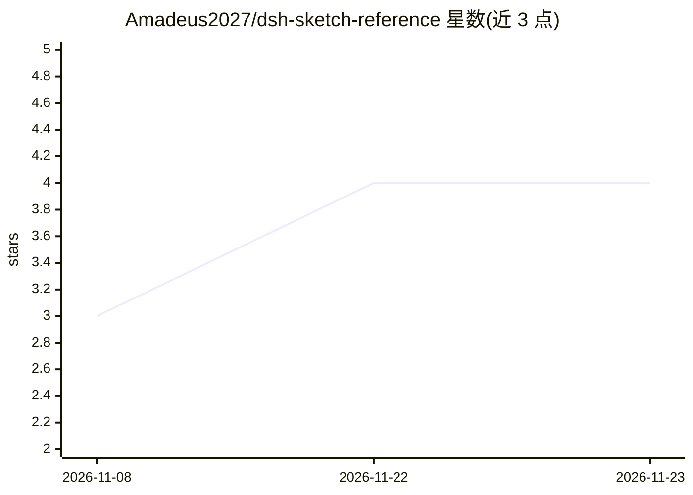

# Amadeus2027/dsh-sketch-reference

⭐ 4 · TypeScript · MIT · 推送 2026-10-22 · [GitHub](https://github.com/Amadeus2027/dsh-sketch-reference) · 个人维护 · 中文 README

**给 DSH 加 Excalidraw 画板，让 Agent 读草图并续做实现**

DSH（DeepSeek Harness）的 Web 插件：在 DSH 会话内嵌入 Excalidraw 画板，用户绘制页面布局、PPT 分区或手绘想法，Sketch Graph 用节点与连线组织页面与细节关系；Agent 可按需读取草图结构与 PNG 导出，可定位到图形的批注，根草图的 AI 修改先预览再确认。草图按会话保存在本地 DSH。作为社区插件，仅适配特定两版 DSH Web alpha 版本，模型读图需视觉能力，存在节点/连线数量上限。

## 筛选速览

| 维度 | 判定 | 备注 |
|---|---|---|
| AI 角色 | `ai-ecosystem` | LLM/agent 周边工具 |
| 许可风险 | `permissive` | MIT |
| 部署形态 | `library` | 以包/库形式分发 |
| 模型依赖 | — | README 未给出锁定关系 |
| 硬件要求 | — | 无带数字的原话,不猜 |
| 安装摩擦 | `low` | 无编译、无系统依赖或容器化 |
| 成熟度 | `idea` | |

## 能力要点

- Excalidraw 画板嵌入 DSH 会话，草图按会话保存
- Sketch Graph 节点组织页面跳转与细节展开，Agent 按需读取
- AI 修改提议先预览后确认，批注可定位到图形

## 适用场景

- 画出网页布局与跳转关系，让 Agent 按草图实现页面
- 画出每页内容分区，让 Agent 生成可编辑幻灯片
- 在草图上批注细节并与 Agent 讨论纠正

## 场景标签

`编码 Agent` `AI 写作` · 领域:编码与开发

## 证据(README 行号)

> L9: **在 DSH 会话里画草图，让 Agent 读图、讨论并继续实现。** 用 Excalidraw 表达页面布局、PPT 分区或手绘想法；用 Sketch Graph 串联页面与细节。原生聊天、工作区和模型配置继续沿用 DSH。
> L89: - 本插件提供可编辑参考和协作工具；网页与 PPT 由 DSH Agent 及其工作区工具实现。选区重点不约束其他宿主工具，也不清除聊天历史。
> L86: - 社区插件，适配上述两版 DSH Web；其他宿主版本、移动端和全部插件组合未作兼容承诺。模型读取图像需要视觉能力；基础绘图、保存与导出独立可用。

## 星数曲线

2026-11-08 3 → 2026-11-23 4（+1）

---
*卡片 v1 · prompt 1.4 · 生成 2026-11-22 · 置信度 high · 依据 README sha `719a7c6384fa` · [字段定义](../../DATASET.md)*
