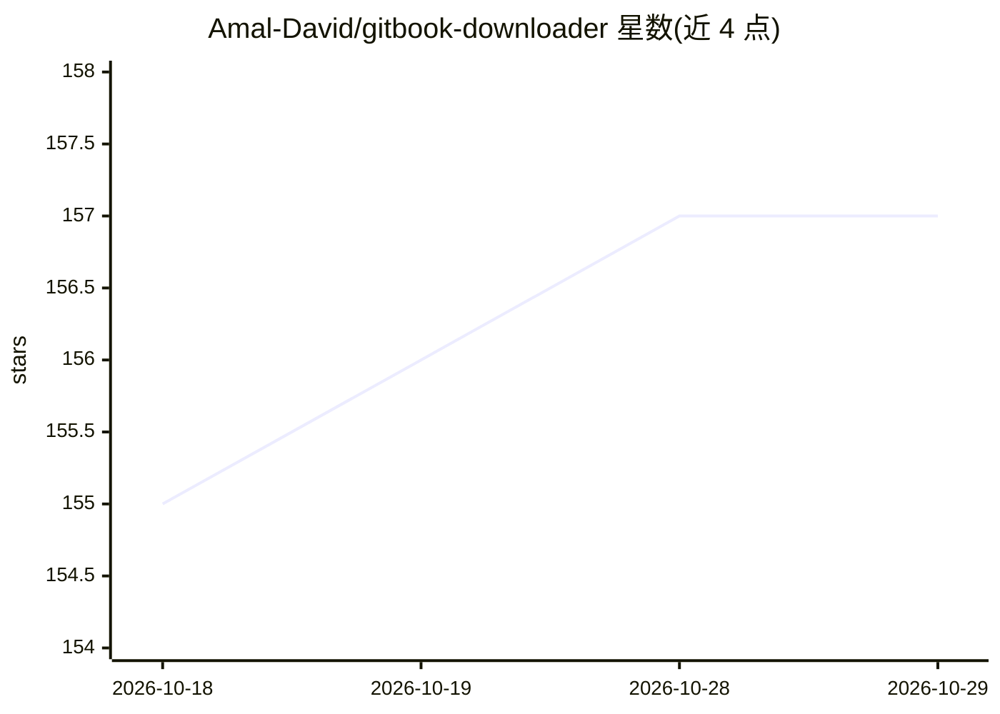

# Amal-David/gitbook-downloader

⭐ 157 · Python · 推送 2026-05-12 · [GitHub](https://github.com/Amal-David/gitbook-downloader) · [官网](https://docingest.com) · 个人维护

**把文档站点抓取转为 Markdown 供 LLM 与编程 agent 使用**

Python 编写的文档站点下载工具：通过插件式提取器（Mintlify/Vocs/Docusaurus/GitBook 及通用回退）自动识别平台并抓取导航与正文，去除侧栏等样板内容后生成 Markdown 与目录，支持章节过滤、版本路径过滤、内容去重与限速重试。提供 CLI 与 Flask Web 界面两种使用方式，产出用于 Claude Code、Codex 等 AI 助手的知识库或上下文。已知限制：JS 折叠导航、客户端渲染侧栏的站点可能遗漏目录项。

## 筛选速览

| 维度 | 判定 | 备注 |
|---|---|---|
| AI 角色 | `ai-ecosystem` | LLM/agent 周边工具 |
| 许可风险 | `none` | — |
| 部署形态 | `None` |  |
| 模型依赖 | — | README 未给出锁定关系 |
| 硬件要求 | — | 无带数字的原话,不猜 |
| 安装摩擦 | `low` | 无编译、无系统依赖或容器化 |
| 成熟度 | — | 结构信号不足 |

## 能力要点

- 插件式提取器架构，自动检测 Mintlify/Vocs/Docusaurus/GitBook 等平台
- 生成带层级目录的 Markdown，去除导航与样板内容
- 章节过滤、版本路径过滤与内容哈希去重
- 提供 CLI 与本地 Web 界面（localhost:8080）

## 适用场景

- 把项目文档站下载成 Markdown 投喂给 Claude Code/Codex 等编程 agent
- 为 AI 助手构建文档知识库
- 只下载大型文档站中某个章节作参考材料

## 场景标签

`网页抓取` · 领域:效率与自动化

## 证据(README 行号)

> L5: A tool that converts documentation sites into markdown format, optimized for use with coding agents and AI assistant
> L12: - Create knowledge bases for Claude Code, Codex, Hermes, Pi, and other AI assistants
> L13: - Feed documentation into context windows of AI chatbots

## 星数曲线

2026-10-18 155 → 2026-10-29 157（+2）

---
*卡片 v1 · prompt 1.4 · 生成 2026-10-23 · 置信度 high · 依据 README sha `ef54d7152aef` · [字段定义](../../DATASET.md)*
