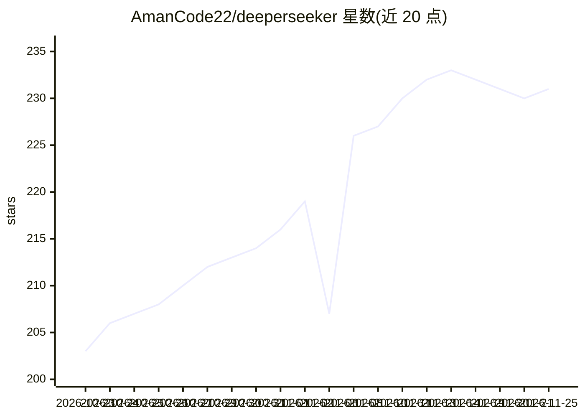

# AmanCode22/deeperseeker

⭐ 231 · Python · NOASSERTION · 推送 2026-11-23 · [GitHub](https://github.com/AmanCode22/deeperseeker) · 个人维护

**自托管的 DeepSeek 网页会话反向代理，将其转换为 OpenAI/Anthropic 兼容的 API 端点**

基于 FastAPI 的反向代理，通过 Playwright (patchright) 与 DeepSeek Web 界面进行交互，持有用户的 Web 会话 Token，并提供兼容 OpenAI 和 Anthropic 格式的 API 端点（包括流式传输、工具调用、文件和视觉能力）。由于它逆向工程了 DeepSeek 的 Web 接口而非使用官方 API，自动化访问违反了 DeepSeek 的服务条款，且存在账号被封禁的风险。支持 Docker 镜像、Compose 或本地 Python 运行。需要配置管理员密码进行安全防护。

## 筛选速览

| 维度 | 判定 | 备注 |
|---|---|---|
| AI 角色 | `ai-ecosystem` | LLM/agent 周边工具 |
| 许可风险 | `none` | NOASSERTION |
| 部署形态 | `self-host` | docker 或自建部署 |
| 模型依赖 | locked-api |  |
| 硬件要求 | — | 无带数字的原话,不猜 |
| 安装摩擦 | `low` | 无编译、无系统依赖或容器化 |
| 成熟度 | — | 结构信号不足 |

## 能力要点

- 将 DeepSeek Web 会话转换为 OpenAI 及 Anthropic 兼容的 API 端点
- 支持流式响应、工具调用、文件处理及视觉能力
- 包含用于 Token 池与使用统计的仪表盘
- 基于 Patchright (隐身 Playwright) 与 Chromium 运行

## 适用场景

- 通过兼容 OpenAI 格式的客户端调用个人 DeepSeek 账号能力
- 在本地工具链中通过 API 调用 DeepSeek 服务
- 将 DeepSeek Web 端能力集成到自定义 Agent 工作流中

## 场景标签

`模型网关` · 领域:Agent 开发

## 证据(README 行号)

> L8: A self-hosted reverse proxy that turns a DeepSeek web session into an **OpenAI- and Anthropic-compatible API** — Fas
> L16: DeeperSeeker runs on your machine, holds one or more of your own DeepSeek web
> L18: `/v1/responses`, `/v1/messages`) that talk to the DeepSeek web backend for

## 星数曲线

2026-10-23 203 → 2026-11-25 231（+28）

---
*卡片 v1 · prompt 1.4 · 生成 2026-11-25 · 置信度 high · 依据 README sha `ef0ebb95fcea` · [字段定义](../../DATASET.md)*
