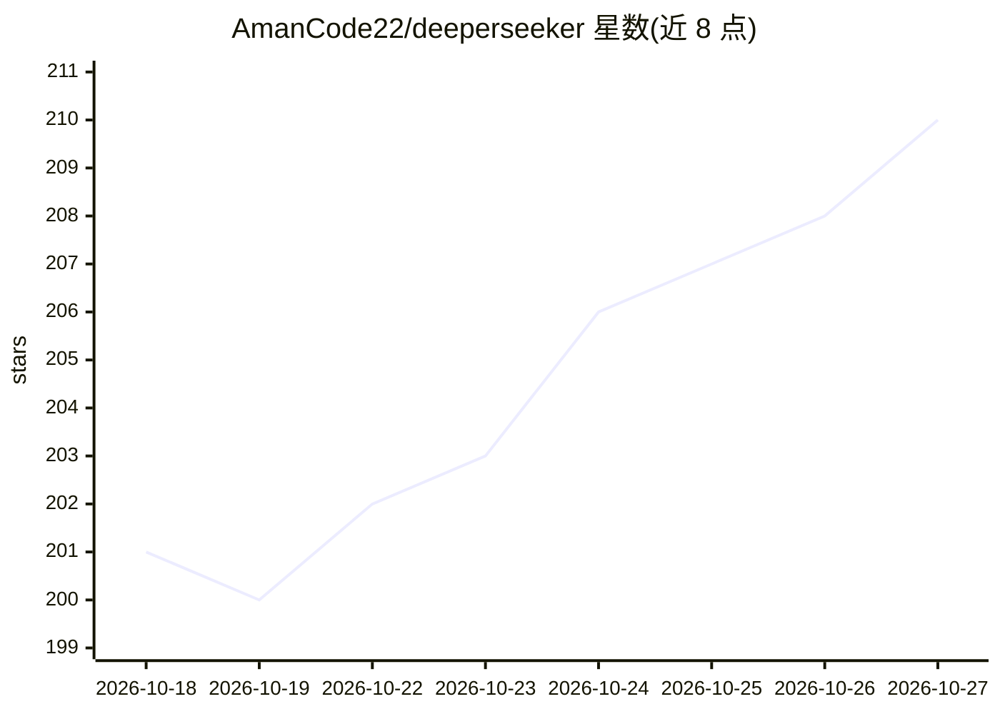

# AmanCode22/deeperseeker

⭐ 210 · Python · NOASSERTION · 推送 2026-10-26 · [GitHub](https://github.com/AmanCode22/deeperseeker) · 个人维护

**把 DeepSeek 网页账号封装为 OpenAI/Anthropic 兼容 API 的反向代理**

基于 FastAPI 的反向代理服务器：用户用自己的 chat.deepseek.com 网页账号 Token 接入，服务端将请求转为 DeepSeek 网页会话，对外暴露 OpenAI（/v1/chat/completions、/v1/responses）与 Anthropic（/v1/messages）兼容端点，支持流式输出、工具调用、视觉与文件上传。机制包括多 Token 池轮换、SHA-256 会话签名恢复、约 393K 上下文触发的摘要滚动续接、限流自动恢复；Playwright/Chromium 已弃用仅作备份。README 明示自动化使用违反 DeepSeek 服务条款，账号可能被封禁。提供 uv/venv 本地运行与 Docker/Podman 部署，附 Dashboard。

## 筛选速览

| 维度 | 判定 | 备注 |
|---|---|---|
| AI 角色 | `ai-ecosystem` | LLM/agent 周边工具 |
| 许可风险 | `none` | NOASSERTION |
| 部署形态 | `library` | 以包/库形式分发 |
| 模型依赖 | locked-api |  |
| 硬件要求 | — | 无带数字的原话,不猜 |
| 安装摩擦 | `low` | 无编译、无系统依赖或容器化 |
| 成熟度 | — | 结构信号不足 |

## 能力要点

- OpenAI 与 Anthropic 双兼容 API 端点，支持 Claude Desktop 自动发现
- 多 Token 池轮换与限流后自动换 Token 续接上下文
- 长上下文摘要滚动策略（观测记忆上限约 393K，首条消息可接受约 1M）
- 工具调用解析（DSML XML/tool_call/JSON 多格式）与 SSE 流式 think-tag 重组

## 适用场景

- 把已有的 DeepSeek 网页账号接入 OpenAI/Anthropic 客户端工具链
- 在 Claude Desktop 中通过兼容端点使用 DeepSeek 网页会话
- 个人用途下用统一 API 格式调用 DeepSeek 的工具调用与视觉能力

## 场景标签

`模型网关` · 领域:Agent 开发

## 证据(README 行号)

> L4: DeepSeek website reverse-proxy server with FastAPI, supporting OpenAI & Anthropic API standards.
> L96: - **OpenAI Base**: `http://localhost:4000/v1`
> L103: - **Anthropic Base**: `http://localhost:4000`

## 星数曲线

2026-10-18 201 → 2026-10-27 210（+9）

---
*卡片 v1 · prompt 1.4 · 生成 2026-10-22 · 置信度 mid · 依据 README sha `dae45fab2779` · [字段定义](../../DATASET.md)*
