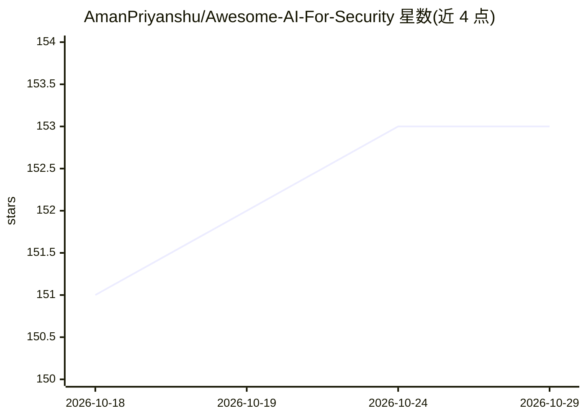

# AmanPriyanshu/Awesome-AI-For-Security

⭐ 153 · CC0-1.0 · 推送 2026-10-05 · [GitHub](https://github.com/AmanPriyanshu/Awesome-AI-For-Security) · [官网](https://amanpriyanshu.github.io/Awesome-AI-For-Security/) · 个人维护

**AI 应用于网络安全的工具/论文/数据集策展清单**

策展类 awesome 清单：汇集将 LLM、Agent、多模态等 AI 技术应用于网络安全任务的模型、数据集、基准、论文、工具与安全 Agent。条目按类别组织：专用安全模型（Foundation-Sec、Antares 等）、预训练与指令微调数据集、漏洞评估与威胁情报基准、对抗 ML 与红队工具，以及自主渗透测试/安全审计 Agent。面向安全研究者和从业者选型参考，仓库以 CC0 许可发布，无安装运行需求。

## 筛选速览

| 维度 | 判定 | 备注 |
|---|---|---|
| AI 角色 | `ai-knowledge` | 知识聚合/清单类 |
| 许可风险 | `viral` | CC0-1.0 |
| 部署形态 | `None` |  |
| 模型依赖 | — | README 未给出锁定关系 |
| 硬件要求 | — | 无带数字的原话,不猜 |
| 安装摩擦 | `low` | 无编译、无系统依赖或容器化 |
| 成熟度 | — | 结构信号不足 |

## 能力要点

- 收录专用安全模型、数据集、基准、工具与安全 Agent 六大类资源
- 覆盖漏洞定位、CTI、CTF 攻防、对抗 ML 等安全场景
- 含 OWASP Agent Memory Guard、garak、promptfoo 等工具与相关论文条目

## 适用场景

- 查找面向安全任务的专用 LLM 与微调数据集
- 为 LLM 安全评估寻找基准与红队工具
- 调研自主渗透测试与安全审计 Agent 项目

## 场景标签

`精选清单` `网络安全` · 领域:学习与行业

## 证据(README 行号)

> L3: > A curated list of tools, papers, and datasets for applying AI to cybersecurity tasks. This list primarily focuses 
> L101: ## Tools & Frameworks

## 星数曲线

2026-10-18 151 → 2026-10-29 153（+2）

---
*卡片 v1 · prompt 1.4 · 生成 2026-10-22 · 置信度 high · 依据 README sha `c0c5078ebf52` · [字段定义](../../DATASET.md)*
