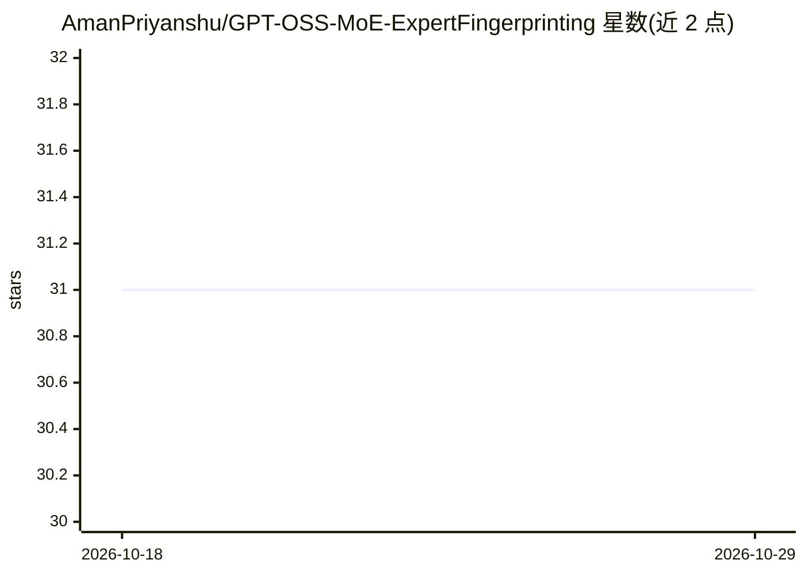

# AmanPriyanshu/GPT-OSS-MoE-ExpertFingerprinting

⭐ 31 · HTML · Apache-2.0 · 推送 2026-02-03 · [GitHub](https://github.com/AmanPriyanshu/GPT-OSS-MoE-ExpertFingerprinting) · [官网](https://amanpriyanshu.github.io/GPT-OSS-MoE-ExpertFingerprinting/) · 个人维护

**分析 GPT-OSS-20B MoE 专家激活规律并发布 232 个剪枝模型**

面向 GPT-OSS-20B 混合专家架构的专家行为分析与剪枝项目：在 24 层上逐 token 记录路由决策，跨 GPQA、MMLU、SORRY-Bench、Tulu3、Polyglot 等基准统计各领域专家激活模式，据此按 8 个领域方向（通用/科学/数学/医学/法律/安全/指令遵循/红队）剪枝生成 232 个模型，参数量从 4.2B 到 20.9B 共 29 档；保留 24 层结构、128K 上下文、RoPE/RMSNorm 与 BF16 精度，Top-k 路由调整为 min(4, num_experts)。另提供网页端专家激活可视化与对比工具。给研究者和需要领域专用模型的开发者使用。

## 筛选速览

| 维度 | 判定 | 备注 |
|---|---|---|
| AI 角色 | `ai-ecosystem` | LLM/agent 周边工具 |
| 许可风险 | `permissive` | Apache-2.0 |
| 部署形态 | `None` |  |
| 模型依赖 | — | README 未给出锁定关系 |
| 硬件要求 | — | 无带数字的原话,不猜 |
| 安装摩擦 | `low` | 无编译、无系统依赖或容器化 |
| 成熟度 | — | 结构信号不足 |

## 能力要点

- 逐 token 记录 24 层路由决策的专家指纹分析
- 按 8 个领域剪枝发布 232 个模型（4.2B–20.9B，29 档参数）
- 剪枝后保留 128K 上下文、RoPE/RMSNorm、BF16 精度
- 网页端专家激活可视化与跨配置对比工具

## 适用场景

- 研究 MoE 模型中专家分工与激活规律
- 按领域选择参数量合适的专用模型部署
- 对比不同剪枝配置下的专家使用差异

## 场景标签

`模型量化` · 领域:训练与推理

## 证据(README 行号)

> L23: This project attempts to conduct an in-depth investigation into expert activation patterns within GPT-OSS-20B's Mix
> L132: ├── inference_on_prompts.py    # Batch inference with router analysis

## 星数曲线

2026-10-18 31 → 2026-10-29 31（+0）

---
*卡片 v1 · prompt 1.4 · 生成 2026-10-26 · 置信度 mid · 依据 README sha `6818b8f5bd7f` · [字段定义](../../DATASET.md)*
