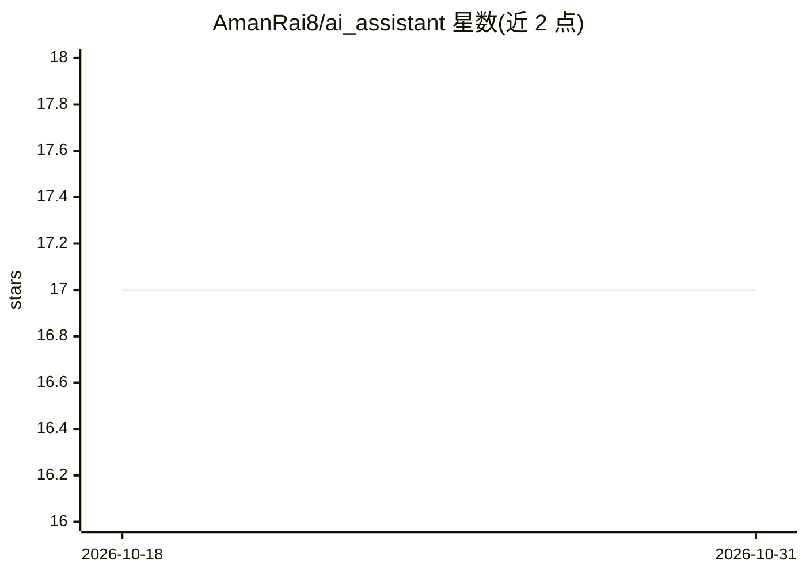

# AmanRai8/ai_assistant

⭐ 17 · TypeScript · MIT · 推送 2026-01-11 · [GitHub](https://github.com/AmanRai8/ai_assistant) · [官网](https://ai-assistant69.vercel.app) · 个人维护

**基于 Next.js 的实时 AI 语音聊天 Web 应用**

面向终端用户的个人 AI 伴侣 Web 应用：通过 Vapi Voice API 实现实时语音对话，支持会话内 AI 记忆；集成 Clerk 登录认证、个人资料页、经 Resend 即时发送不落库的邮件反馈。技术栈为 Next.js/React/Tailwind CSS，数据用 Convex，部署面向 Vercel。安装方式为 git clone 源码后 npm install 并配置 Clerk 等环境变量，再 npm run dev 运行。README 的 clone 步骤重复出现两次且 URL 指向 ai_trainer 仓库。

## 筛选速览

| 维度 | 判定 | 备注 |
|---|---|---|
| AI 角色 | `ai-native` | 本体是模型或模型工具 |
| 许可风险 | `permissive` | MIT |
| 部署形态 | `library` | 以包/库形式分发 |
| 模型依赖 | — | README 未给出锁定关系 |
| 硬件要求 | — | 无带数字的原话,不猜 |
| 安装摩擦 | `low` | 无编译、无系统依赖或容器化 |
| 成熟度 | — | 结构信号不足 |

## 能力要点

- 基于 Vapi Voice API 的实时语音对话，会话内记忆
- Clerk 登录认证与个人资料页
- Resend 邮件反馈，数据不存数据库

## 适用场景

- 通过语音与 AI 进行实时对话
- 管理账户与查看个人会话信息
- 直接向开发者发送邮件反馈

## 场景标签

`语音 Agent` `AI 助手` · 领域:对话与助手

## 证据(README 行号)

> L22: - **Real-time Voice Chat** with AI:
> L48:  - AI powered by a custom **Voice API** (`vapi`) for interactive calls.

## 星数曲线

2026-10-18 17 → 2026-10-31 17（+0）

---
*卡片 v1 · prompt 1.4 · 生成 2026-10-30 · 置信度 high · 依据 README sha `5214128f7f6d` · [字段定义](../../DATASET.md)*
