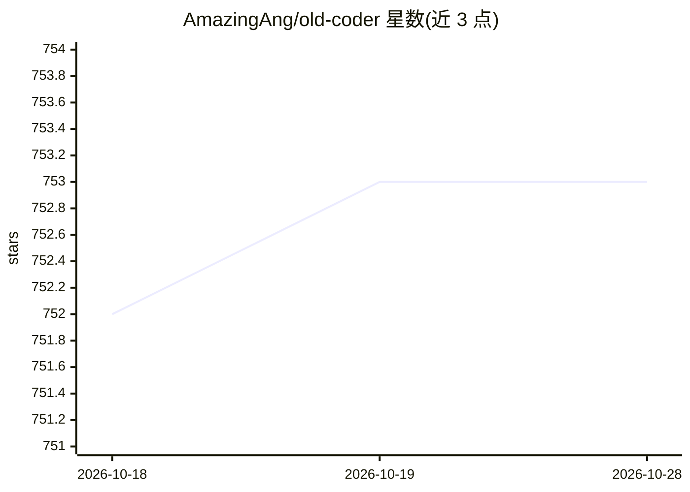

# AmazingAng/old-coder

⭐ 753 · Python · MIT · 推送 2026-08-18 · [GitHub](https://github.com/AmazingAng/old-coder) · 个人维护 · 中文 README

**给编码 agent 的证据优先开发技能：让代码过测试关卡**

以纯 Markdown（SKILL.md）形式交付的编码 agent 工作流技能：要求 agent 编码前提交 SPEC 测试计划供人批准，编码后提交可复跑的 EVIDENCE 证据报告；中间经过测试套件、覆盖率、变异测试、属性测试、真实执行、供应链检查等关卡，强度按风险分级。适用于任何遵循指令的编码 agent（Claude Code、Codex CLI、Cursor、Aider 等），通过 npx skills 安装或手动复制。附带 old-coder-api 技能与一个限流器演示项目。声明限制：无法证明 spec 完整性或自我验证检查器。

## 筛选速览

| 维度 | 判定 | 备注 |
|---|---|---|
| AI 角色 | `ai-ecosystem` | LLM/agent 周边工具 |
| 许可风险 | `permissive` | MIT |
| 部署形态 | `library` | 以包/库形式分发 |
| 模型依赖 | locked-api |  |
| 硬件要求 | — | 无带数字的原话,不猜 |
| 安装摩擦 | `low` | 无编译、无系统依赖或容器化 |
| 成熟度 | — | 结构信号不足 |

## 能力要点

- SPEC（编码前测试计划）→ GAUNTLET（检查关卡）→ EVIDENCE（可复跑证据报告）流程
- 关卡含变更行覆盖率、变异测试、属性测试、供应链与密钥检查等
- 纯 Markdown 技能，兼容任意遵循指令的编码 agent
- 反作弊规则：未运行不得报 pass，未批准 spec 须降低置信声明

## 适用场景

- 不逐行读代码，靠测试计划与证据报告审查 agent 产出
- 为高风险变更（资金、登录、并发）施加全量检查关卡
- 为 HTTP/JSON API 设计补充契约与兼容性审查技能

## 场景标签

`提示工程` · 领域:Agent 开发

## 证据(README 行号)

> L9: A skill that makes coding agents **prove their work**. Instead of you reading every line, the agent pushes its code 
> L11: It's plain markdown, so it works with any coding agent that follows instructions: Claude Code, Codex CLI, Cursor, A

## 星数曲线

2026-10-18 752 → 2026-10-28 753（+1）

---
*卡片 v1 · prompt 1.4 · 生成 2026-10-22 · 置信度 mid · 依据 README sha `c8b80391af25` · [字段定义](../../DATASET.md)*
