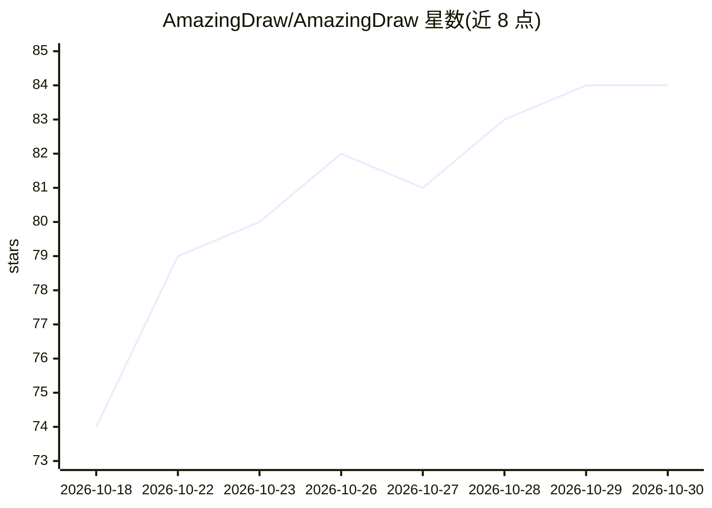

# AmazingDraw/AmazingDraw

⭐ 84 · Python · NOASSERTION · 推送 2026-10-23 · [GitHub](https://github.com/AmazingDraw/AmazingDraw) · [官网](https://t.me/AmazingDraw) · 个人维护 · 中文 README

**本地 ComfyUI 抽卡引擎：一句话生成图片，内置场景/角色库**

面向不会写提示词的图像生成用户的本地工具：内置场景库与角色库，用户用一句自然语言（如“随机抽三张”）即可生成本机 ComfyUI 出图；出图依赖用户自备的 ComfyUI 与模型。提供 WebUI、CLI 与 SKILL.md 三种使用方式，后者可把整个目录交给 Cursor / Claude Code / OpenClaw 等 AI Agent 以对话抽卡。安装通过 GitHub Releases 下载压缩包后运行 install.sh / install.bat，macOS 为主要平台，Python 须与包标签（3.9/3.12）一致。README 以模型推荐表形式给出 DeepSeek Flash、Grok、Gemini Flash 等驱动模型。

## 筛选速览

| 维度 | 判定 | 备注 |
|---|---|---|
| AI 角色 | `ai-native` | 本体是模型或模型工具 |
| 许可风险 | `permissive` | NOASSERTION |
| 部署形态 | `library` | 以包/库形式分发 |
| 模型依赖 | — | README 未给出锁定关系 |
| 硬件要求 | — | 无带数字的原话,不猜 |
| 安装摩擦 | `low` | 无编译、无系统依赖或容器化 |
| 成熟度 | — | 结构信号不足 |

## 能力要点

- 内置场景库/角色库，一句话出图，无需自攒 prompt
- WebUI / CLI / SKILL.md 三种使用形态，Agent 可对话抽卡
- 出图走本机 ComfyUI（默认 127.0.0.1:8188），支持连抽
- Windows 安装脚本可自动补 Git Bash 与匹配的 x64 Python

## 适用场景

- 不会写提示词也能用本地 ComfyUI 生成图片
- 在 Cursor / Claude Code 等 Agent 里对话式抽卡
- 批量连抽或自定义场景/角色预设

## 场景标签

`图像生成` · 领域:内容生成

## 证据(README 行号)

> L11: 解决**不会写提示词的问题**：内置场景库、角色库，想抽什么只需简单一句话，不必自己攒 prompt。
> L68: 出图走本机 ComfyUI（默认 <http://127.0.0.1:8188>）。
> L17: 解压目录根有 `SKILL.md`。把**整个目录**交给 Cursor / Claude Code / OpenClaw / Cherry Studio 等 AI Agent，一句话就能抽卡，例如 `随机抽三张`、`办公室 偷拍

## 星数曲线

2026-10-18 74 → 2026-10-30 84（+10）

---
*卡片 v1 · prompt 1.4 · 生成 2026-10-24 · 置信度 mid · 依据 README sha `291b45991051` · [字段定义](../../DATASET.md)*
