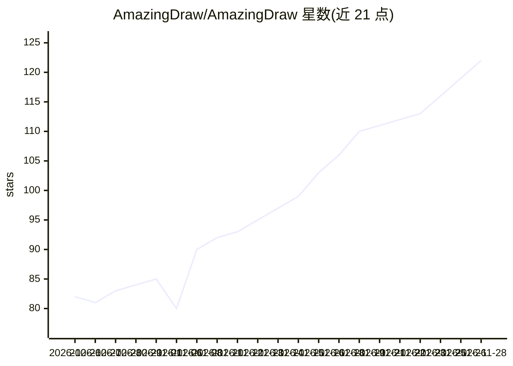

# AmazingDraw/AmazingDraw

⭐ 122 · Python · NOASSERTION · 推送 2026-11-20 · [GitHub](https://github.com/AmazingDraw/AmazingDraw) · [官网](https://t.me/AmazingDraw) · 个人维护 · 中文 README

**给 AI Agent 用的 ComfyUI 抽卡技能包，一句话生成提示词出图**

以 SKILL.md 技能包形式交付的 ComfyUI 出图引擎：内置 16 套词库与场景路由，由 LLM 按「AI 导演」流程组 prompt，投递到本机 ComfyUI 的三套官方工作流渲染，另提供 CLI 连抽与可选 WebUI 卡片工作台。安装方式为 Releases 下载 zip 后运行 install.sh/install.bat；不提供独立图形化界面，需用户已具备 AI Agent（Cursor/dsh/Cherry Studio/Devin 等）使用经验。

## 筛选速览

| 维度 | 判定 | 备注 |
|---|---|---|
| AI 角色 | `ai-native` | 本体是模型或模型工具 |
| 许可风险 | `permissive` | NOASSERTION |
| 部署形态 | `library` | 以包/库形式分发 |
| 模型依赖 | — | README 未给出锁定关系 |
| 硬件要求 | — | 无带数字的原话,不猜 |
| 安装摩擦 | `low` | 无编译、无系统依赖或容器化 |
| 成熟度 | — | 结构信号不足 |

## 能力要点

- SKILL.md 技能包形式，交给支持 Skill/命令行的 AI Agent 即用
- 16 套词库、上百章节，命中场景自动路由选词组 prompt
- 三条 ComfyUI 官方工作流（moss/krea/zi）自动拷入 workflows/
- CLI 连抽与可选 WebUI（fastapi+uvicorn）卡片工作台

## 适用场景

- 用中文口语一句话生成场景提示词并批量出图
- 在 Cursor/dsh 等 Agent 里以技能形式集成抽卡流程
- 管理生成的卡片、相册与渲染队列

## 场景标签

`图像生成` · 领域:内容生成

## 证据(README 行号)

> L16: > **下载 / 安装前先过「灵魂三问」** —— 本项目是给 **AI Agent** 装的 **Skill 技能包**，**不是独立画图软件，没有双击即用的傻瓜界面**。
> L24: 说一句「**温泉旅馆，浴衣半敞，抽一张**」，引擎自己抽场景、选角色、定构图、组 prompt、投进 ComfyUI——你只管开口。
> L32: - 🤖 **Agent 原生** —— `SKILL.md` 交给 Cursor / Antigravity / dsh / Cherry Studio / Devin 即用

## 星数曲线

2026-10-26 82 → 2026-11-28 122（+40）

---
*卡片 v1 · prompt 1.4 · 生成 2026-11-28 · 置信度 mid · 依据 README sha `fc92d5ffdb29` · [字段定义](../../DATASET.md)*
