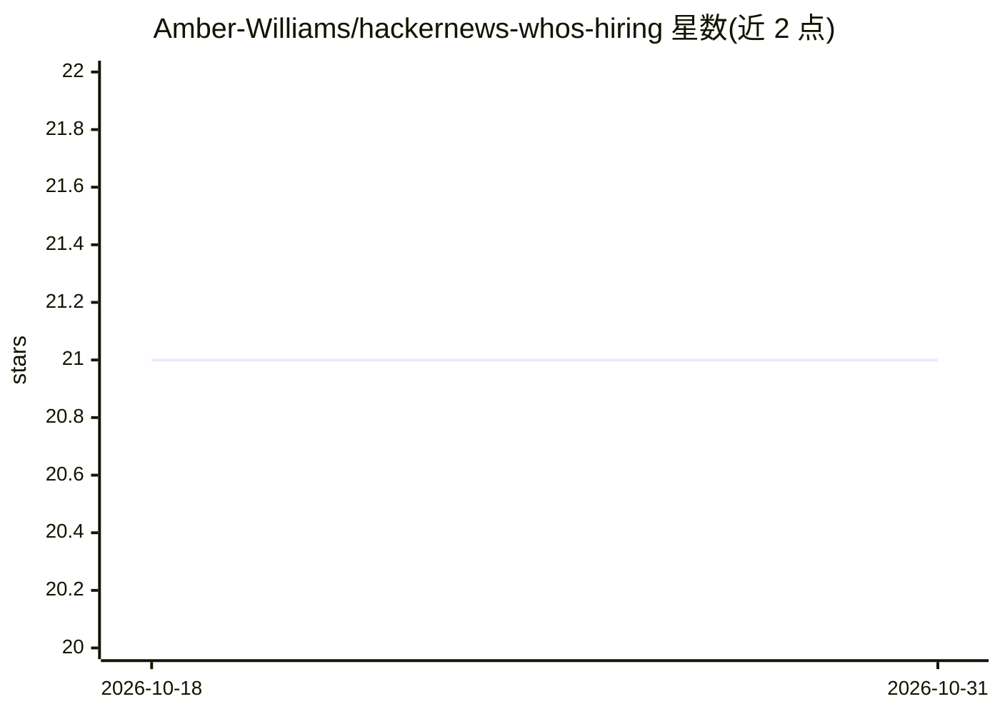

# Amber-Williams/hackernews-whos-hiring

⭐ 21 · Python · MIT · 推送 2026-04-15 · [GitHub](https://github.com/Amber-Williams/hackernews-whos-hiring) · [官网](https://amber-williams.github.io/hackernews-whos-hiring) · 个人维护

**自动抓取 HN 招聘帖生成 Markdown 表与 SQLite 数据库**

用 GitHub Actions 定期抓取并解析 Hacker News 每月 Who's hiring 帖子，输出易读的 Markdown 表格和可通过 Web 访问的 SQLite 数据库。数据按月分表，覆盖 2022 年 12 月至 2025 年 10 月。主题标签含 llm、pandas、pydantic、sql-wasm，提示解析流程涉及 LLM 与数据处理库。运行需 Python 3.10+ 与 poetry，复制 .env.example 配置 API key 后用 poetry 命令执行抓取与报告脚本。

## 筛选速览

| 维度 | 判定 | 备注 |
|---|---|---|
| AI 角色 | `ai-enhanced` | 去掉 AI 部分产品仍成立 |
| 许可风险 | `permissive` | MIT |
| 部署形态 | `None` |  |
| 模型依赖 | — | README 未给出锁定关系 |
| 硬件要求 | — | 无带数字的原话,不猜 |
| 安装摩擦 | `low` | 无编译、无系统依赖或容器化 |
| 成熟度 | — | 结构信号不足 |

## 能力要点

- 自动抓取并解析每月 Who's hiring 帖子
- 输出 Markdown 表格与 Web 可访问的 SQLite 数据库
- 按月分表，覆盖 2022-12 至 2025-10
- 通过 GitHub Actions 自动化运行

## 适用场景

- 查询 Hacker News 招聘帖的历史职位数据
- 用 SQL 分析各月招聘趋势与职位分布
- 获取结构化版本的招聘帖内容便于阅读

## 场景标签

`网页抓取` · 领域:效率与自动化

## 证据(README 行号)

> L3: Automatically scraps and parses monthly hackernew's who's hiring thread into easy to read markdown table and web acc

## 星数曲线

2026-10-18 21 → 2026-10-31 21（+0）

---
*卡片 v1 · prompt 1.4 · 生成 2026-10-28 · 置信度 mid · 依据 README sha `bf3558a57d88` · [字段定义](../../DATASET.md)*
