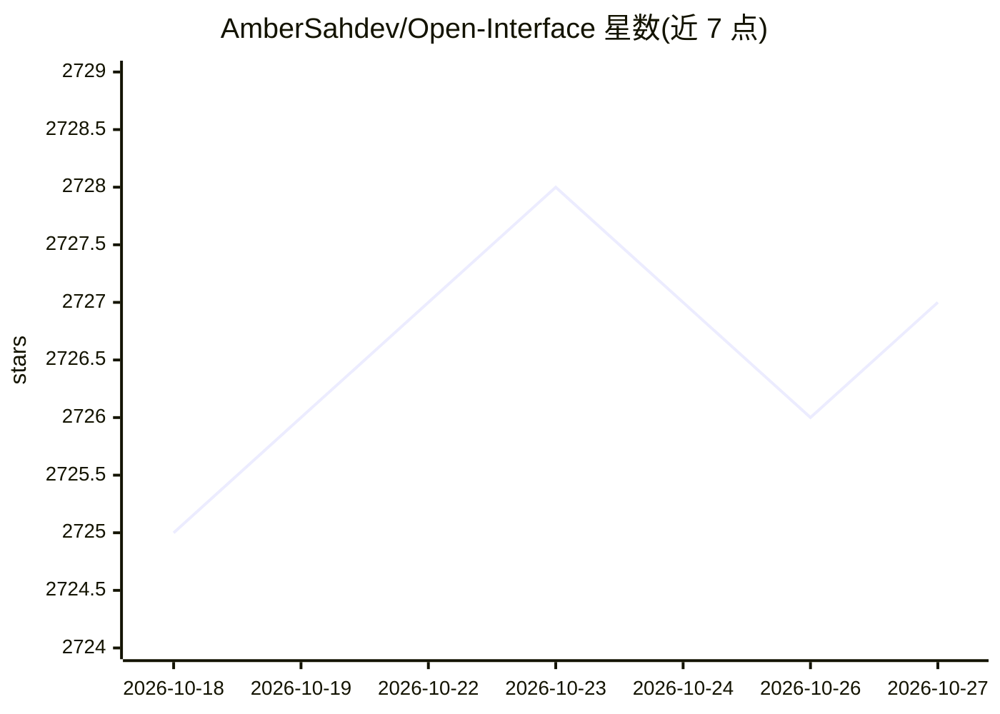

# AmberSahdev/Open-Interface

⭐ 2,727 · Python · GPL-3.0 · 推送 2026-07-17 · [GitHub](https://github.com/AmberSahdev/Open-Interface) · 个人维护

**用 LLM 操控电脑的桌面应用：替用户执行键鼠操作**

跨平台桌面应用（macOS/Linux/Windows）：将用户请求发送至 LLM 后端（OpenAI GPT-4o、Google Gemini）生成操作步骤，通过模拟键盘鼠标输入自动执行，并截取屏幕截图反馈给模型以纠偏。也支持配置任意 OpenAI API 风格的自定义模型（如 Llava、Llama）作为后端。可通过下载预编译二进制或以 Python 3.12+ 脚本方式运行。README 列出当前在空间推理、表格操作与复杂 GUI 应用导航上易出错。

## 筛选速览

| 维度 | 判定 | 备注 |
|---|---|---|
| AI 角色 | `ai-native` | 本体是模型或模型工具 |
| 许可风险 | `viral` | GPL-3.0 |
| 部署形态 | `library` | 以包/库形式分发 |
| 模型依赖 | — | README 未给出锁定关系 |
| 硬件要求 | — | 无带数字的原话,不猜 |
| 安装摩擦 | `low` | 无编译、无系统依赖或容器化 |
| 成熟度 | — | 结构信号不足 |

## 能力要点

- LLM 生成步骤并模拟键盘鼠标自动执行
- 截图反馈给模型实现自我纠偏
- 支持 OpenAI、Gemini 及任意 OpenAI 风格 API 的自定义后端
- 提供 macOS/Linux/Windows 二进制与 Python 脚本两种运行方式

## 适用场景

- 用自然语言让应用代为操作电脑完成任务
- 自动化跨应用的重复性桌面操作
- 接入自选 LLM 后端驱动本机操作

## 场景标签

`GUI 自动化` `AI 助手` · 领域:效率与自动化

## 证据(README 行号)

> L8: - Self-drives your computer by sending your requests to an LLM backend (GPT-4o, Gemini, etc) to figure out the requi
> L9: - Automatically executes these steps by simulating keyboard and mouse input.

## 星数曲线

2026-10-18 2,725 → 2026-10-27 2,727（+2）

---
*卡片 v1 · prompt 1.4 · 生成 2026-10-21 · 置信度 mid · 依据 README sha `54b0dd59bcf4` · [字段定义](../../DATASET.md)*
