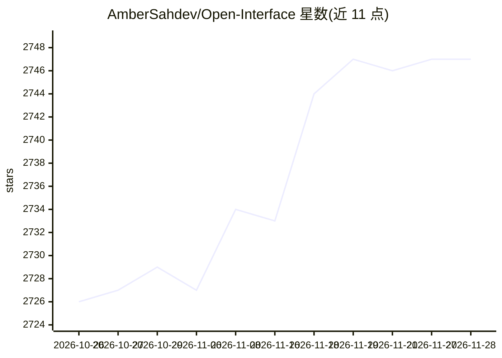

# AmberSahdev/Open-Interface

⭐ 2,747 · Python · GPL-3.0 · 推送 2026-11-18 · [GitHub](https://github.com/AmberSahdev/Open-Interface) · 个人维护

**让 LLM 自动操作键鼠完成电脑任务 的桌面应用**

Open Interface 将用户请求发给 LLM 后端（GPT-4o、Gemini 等）解析出操作步骤，通过模拟键盘和鼠标输入自动执行，并在需要时把进度截图回传给 LLM 修正路径。提供 macOS（Apple Silicon 与 Intel 分包）、Linux（Ubuntu 20.04 测试）、Windows 安装包，也可用 Python 3.12+ 从源码运行。需配置 OpenAI 或 Gemini API key，支持自定义 OpenAI 风格 API 的本地模型。作者注明其在精确空间点击、表格类应用和重度依赖鼠标的 GUI 应用中易出错。

## 筛选速览

| 维度 | 判定 | 备注 |
|---|---|---|
| AI 角色 | `ai-native` | 本体是模型或模型工具 |
| 许可风险 | `viral` | GPL-3.0 |
| 部署形态 | `library` | 以包/库形式分发 |
| 模型依赖 | — | README 未给出锁定关系 |
| 硬件要求 | — | 无带数字的原话,不猜 |
| 安装摩擦 | `low` | 无编译、无系统依赖或容器化 |
| 成熟度 | — | 结构信号不足 |

## 能力要点

- 请求→LLM 规划步骤→模拟键鼠执行→截图回传修正的闭环
- 支持 GPT-4o、Gemini 及任意 OpenAI 风格 API 的自定义后端（如 Llava/Llama）
- 提供 macOS/Linux/Windows 安装包，亦可源码运行
- 可随时用 Stop 按钮或鼠标移到屏幕角落中断

## 适用场景

- 用自然语言让电脑自动完成 Wordle 等小任务
- 让 AI 代为起草 Google Docs 中的文档
- 给应用生成一个简单 Web App 原型

## 场景标签

`GUI 自动化` `AI 助手` · 领域:效率与自动化

## 证据(README 行号)

> L8: - Self-drives your computer by sending your requests to an LLM backend (GPT-4o, Gemini, etc) to figure out the requi
> L9: - Automatically executes these steps by simulating keyboard and mouse input.
> L133: - Open Interface supports using other OpenAI API style LLMs (such as Llava) as a backend and can be configured eas

## 星数曲线

2026-10-26 2,726 → 2026-11-28 2,747（+21）

---
*卡片 v1 · prompt 1.4 · 生成 2026-11-23 · 置信度 high · 依据 README sha `302bf557e28e` · [字段定义](../../DATASET.md)*
