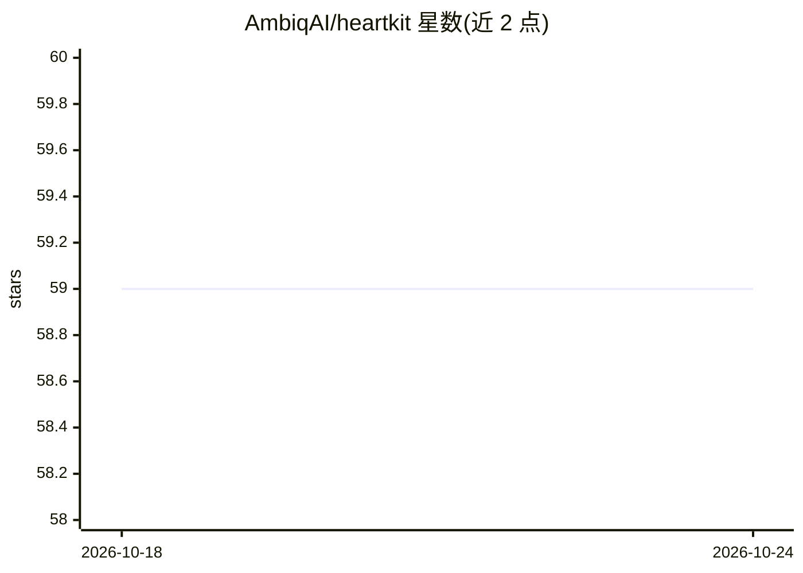

# AmbiqAI/heartkit

⭐ 59 · HTML · BSD-3-Clause · 推送 2026-10-07 · [GitHub](https://github.com/AmbiqAI/heartkit) · [官网](https://ambiqai.github.io/heartkit/) · 组织维护

**面向 Ambiq 超低功耗 SoC 的实时心脏监测 AI 开发套件**

由 AmbiqAI 维护的 AI 开发套件（ADK），供开发者在超低功耗 SoC 上训练并部署实时心脏监测模型。内置降噪、ECG/PPG 分割、心律检测（AFIB/AFL）、心拍分类等任务，各任务提供训练/评估/导出例程；通过模型工厂支持 TCN、U-Net、Conformer 等 10 种架构并可注册自定义模型；提供 Icentia11k、PTB-XL 等开源 ECG 数据集的下载与生成、模型 Zoo 及预训练模型，可导出 TensorFlow Lite/TFLM 并在 Ambiq EVB 上运行演示。以 pip 包或源码（uv）安装，CLI 与 Python 包两种使用方式。

## 筛选速览

| 维度 | 判定 | 备注 |
|---|---|---|
| AI 角色 | `ai-native` | 本体是模型或模型工具 |
| 许可风险 | `permissive` | BSD-3-Clause |
| 部署形态 | `library` | 以包/库形式分发 |
| 模型依赖 | — | README 未给出锁定关系 |
| 硬件要求 | — | 无带数字的原话,不猜 |
| 安装摩擦 | `low` | 无编译、无系统依赖或容器化 |
| 成熟度 | — | 结构信号不足 |

## 能力要点

- 降噪/分割/心律检测/心拍分类四类内置任务，支持 BYOT 自定义任务
- 10 种模型架构（TCN、U-Net、Conformer 等）并可注册自定义模型
- 内置 6 个开源 ECG 数据集及数据集工厂，支持 BYOD
- 提供预训练 Model Zoo 并导出 TensorFlow Lite/TFLM 至 Ambiq SoC

## 适用场景

- 在 Ambiq 超低功耗 SoC 上训练部署实时心脏监测模型
- 利用 PTB-XL 等公开 ECG 数据做心律/心拍分类模型的训练与评估
- 通过配置文件定制任务工作流并在 EVB 上运行演示

## 场景标签

`模型训练` `模型评测` · 领域:评测与运维

## 证据(README 行号)

> L9: heartKIT is an AI Development Kit (ADK) that enables developers to easily train and deploy real-time __heart-monitor
> L57: - **Rhythm**: Heart rhythm detection (AFIB, AFL)

## 星数曲线

2026-10-18 59 → 2026-10-24 59（+0）

---
*卡片 v1 · prompt 1.4 · 生成 2026-10-24 · 置信度 high · 依据 README sha `854536263c33` · [字段定义](../../DATASET.md)*
