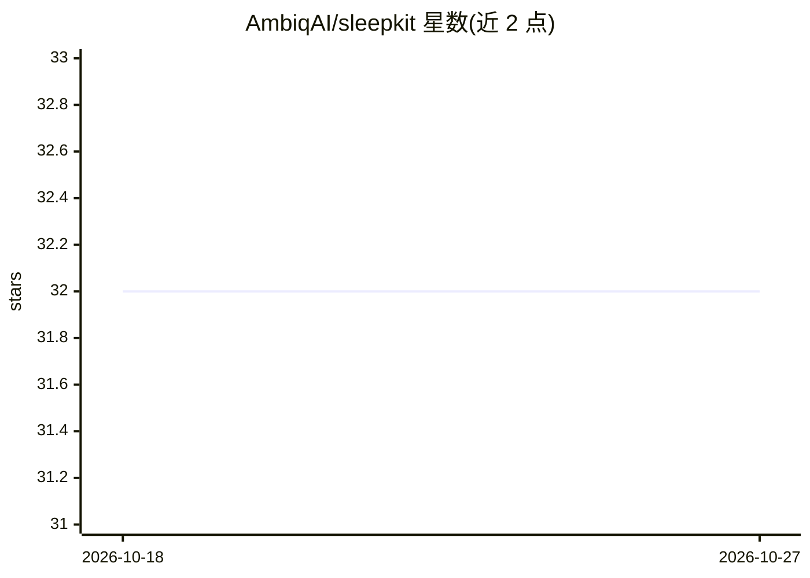

# AmbiqAI/sleepkit

⭐ 32 · HTML · BSD-3-Clause · 推送 2026-10-25 · [GitHub](https://github.com/AmbiqAI/sleepkit) · [官网](https://ambiqai.github.io/sleepkit/) · 组织维护

**超低功耗 Ambiq SoC 上的实时睡眠监测 AI 开发套件**

面向嵌入式设备构建与部署实时睡眠监测模型（睡眠分期、呼吸暂停检测、睡眠/不动检测）。提供数据集接口（MESA/CMIDSS/YSYW/STAGES）、模型工厂、预训练模型库，支持训练、评估、导出到 TF Lite/TFLM，可在 PC 或 EVB 上运行演示。面向 Ambiq 超低功耗 SoC 部署，需 Python 3.12 与 uv，编译/烧录 EVB 演示另需 Arm GNU Toolchain 与 Segger J-Link。以 Python 包与 CLI 两种形式使用。

## 筛选速览

| 维度 | 判定 | 备注 |
|---|---|---|
| AI 角色 | `ai-native` | 本体是模型或模型工具 |
| 许可风险 | `permissive` | BSD-3-Clause |
| 部署形态 | `library` | 以包/库形式分发 |
| 模型依赖 | — | README 未给出锁定关系 |
| 硬件要求 | — | 无带数字的原话,不猜 |
| 安装摩擦 | `low` | 无编译、无系统依赖或容器化 |
| 成熟度 | — | 结构信号不足 |

## 能力要点

- 内置 Detect/Stage/Apnea 三类睡眠任务及训练、评估、导出例程
- 预训练模型库含配置文件与精度/召回/F1 指标，可导出 TF Lite/TFLM
- 数据集工厂覆盖 MESA、CMIDSS、YSYW、STAGES 等研究数据集
- 可在 PC 或 Ambiq EVB 硬件上运行任务级演示

## 适用场景

- 在电池供电的可穿戴设备上做实时睡眠分期或呼吸暂停检测
- 基于研究数据集训练并评估自己的睡眠模型
- 将训练好的模型导出为 TFLM 部署到 Ambiq SoC

## 场景标签

`模型训练` · 领域:训练与推理

## 证据(README 行号)

> L13: sleepKIT is an AI Development Kit (ADK) that enables developers to easily build and deploy real-time __sleep-monito
> L59: - **Detect**: Detect sustained sleep/inactivity bouts
> L61: - **Apnea**: Detect hypopnea/apnea events

## 星数曲线

2026-10-18 32 → 2026-10-27 32（+0）

---
*卡片 v1 · prompt 1.4 · 生成 2026-10-26 · 置信度 high · 依据 README sha `09cd9006c652` · [字段定义](../../DATASET.md)*
