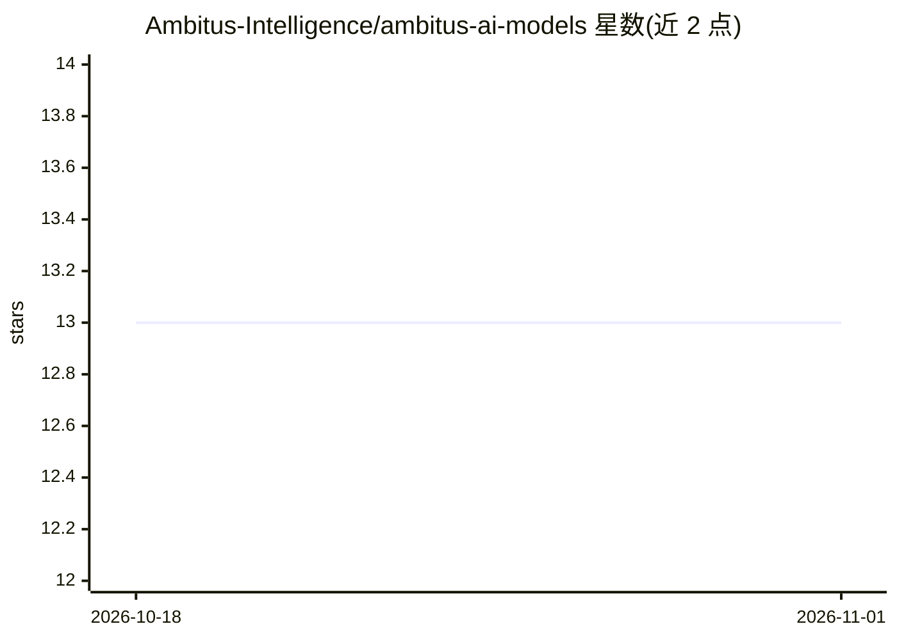

# Ambitus-Intelligence/ambitus-ai-models

⭐ 13 · Jupyter Notebook · 推送 2025-11-05 · [GitHub](https://github.com/Ambitus-Intelligence/ambitus-ai-models) · [官网](https://pypi.org/project/ambitus-cli/) · 组织维护

**多智能体市场研究引擎，编排数据采集分析并生成引证报告**

TUI 优先的 Python 包，作为自动化市场研究平台的核心引擎：由中央 Orchestrator 顺序调度多个专用 AI 智能体（公司调研、行业分析、市场数据、竞争格局、缺口分析、机会识别、报告合成），通过基于 FastMCP 的 MCP 工具服务器（ambitus-tools-mcp）在运行时发现并调用抓取器、API 客户端与 CitationAgent 等外部工具。各智能体输出结构化 JSON 持久化到数据库并经 REST 暴露，最终聚合为含引证的 Markdown/HTML/PDF 报告。README 未给出安装命令。

## 筛选速览

| 维度 | 判定 | 备注 |
|---|---|---|
| AI 角色 | `ai-native` | 本体是模型或模型工具 |
| 许可风险 | `none` | — |
| 部署形态 | `None` |  |
| 模型依赖 | — | README 未给出锁定关系 |
| 硬件要求 | — | 无带数字的原话,不猜 |
| 安装摩擦 | `low` | 无编译、无系统依赖或容器化 |
| 成熟度 | — | 结构信号不足 |

## 能力要点

- Orchestrator 编排 7 个专用智能体并处理错误流与用户交接
- FastMCP 支撑的 MCP 工具服务器承载抓取器、API 客户端与 CitationAgent
- 智能体输出结构化 JSON，持久化到数据库并经 REST 暴露
- 最终聚合为引证丰富的 Markdown/HTML/PDF 报告

## 适用场景

- 自动化生成一家公司的市场研究报告
- 让智能体从 Crunchbase、Google Trends、Statista 等来源采集并验证数据
- 分析竞争格局并识别增长机会

## 场景标签

`多智能体` `数据分析` · 领域:Agent 开发

## 证据(README 行号)

> L3: Ambitus Intelligence is a TUI‑first Python package and multi‑agent market research engine that orchestrates validate
> L15: `ambitus-ai-models` is the core engine behind Ambitus Intelligence’s automated market research platform. It provide
> L36: |**ReportSynthesisAgent**|Aggregate all agent outputs into a citation‑rich final report (Markdown, HTML, PDF).|

## 星数曲线

2026-10-18 13 → 2026-11-01 13（+0）

---
*卡片 v1 · prompt 1.4 · 生成 2026-10-31 · 置信度 high · 依据 README sha `ffbc063cd06d` · [字段定义](../../DATASET.md)*
