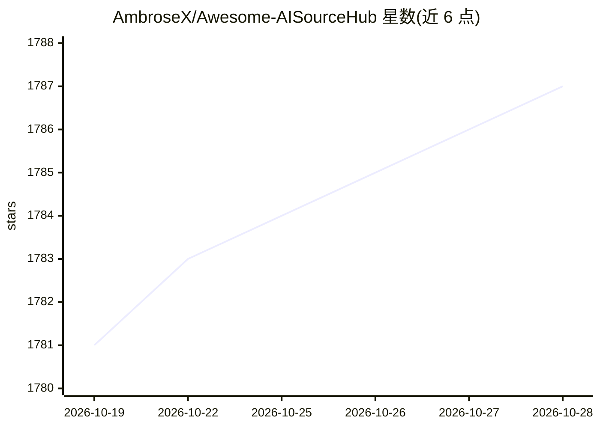

# AmbroseX/Awesome-AISourceHub

⭐ 1,789 · TypeScript · MIT · 推送 2026-10-19 · [GitHub](https://github.com/AmbroseX/Awesome-AISourceHub) · [官网](https://aiguanchao.com) · 个人维护 · 中文 README

**AI 科技领域信息源策展清单：聚合推特/公众号/知乎等渠道账号**

收集 AI 科技领域高质量信息源的 awesome 类清单仓库，按资讯平台、X（推特）大 V、公众号、网站、播客、博客、知乎、B 站 Up 主、油管、电报等类别组织条目，每条附平台与备注说明。另附信息源筛选方法论（时间线设置、从关注列表深挖、谷歌学术/Arxiv/PaperWithCode 检索技巧）与 Fork/PR 贡献流程，还提供表单提交信息源的渠道。条目备注包含维护者对内容质量的主观描述。

## 筛选速览

| 维度 | 判定 | 备注 |
|---|---|---|
| AI 角色 | `ai-knowledge` | 知识聚合/清单类 |
| 许可风险 | `permissive` | MIT |
| 部署形态 | `None` |  |
| 模型依赖 | — | README 未给出锁定关系 |
| 硬件要求 | — | 无带数字的原话,不猜 |
| 安装摩擦 | `low` | 无编译、无系统依赖或容器化 |
| 成熟度 | — | 结构信号不足 |

## 能力要点

- 按 10+ 平台类别组织 AI 信息源条目并附备注
- 附信息源筛选与领域调研方法论（时间线、Arxiv、PaperWithCode 等）
- 支持 Fork/PR 与表单两种贡献方式

## 适用场景

- 寻找值得关注的 AI 领域推特账号与中文公众号
- 了解各平台（知乎/B站/播客/电报）的 AI 内容创作者分布
- 学习筛选 AI 信息源、避免信息茧房的方法

## 场景标签

`精选清单` · 领域:学习与行业

## 证据(README 行号)

> L5: 本仓库收集 AI 科技领域高质量信息源。
> L27: 平台：知乎博主、B 站 up 主、油管 Up、知识星球、电报、公众号、推特大 V、垂类 AI 网站

## 星数曲线

2026-10-19 1,781 → 2026-10-28 1,787（+6）

---
*卡片 v1 · prompt 1.4 · 生成 2026-10-21 · 置信度 high · 依据 README sha `24ada9bcbb93` · [字段定义](../../DATASET.md)*
