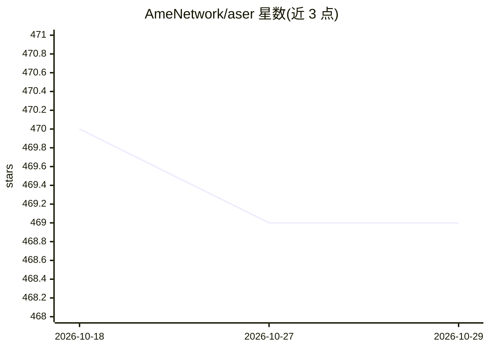

# AmeNetwork/aser

⭐ 469 · Python · MIT · 推送 2026-10-19 · [GitHub](https://github.com/AmeNetwork/aser) · [官网](https://ame.network/) · 组织维护 · 中文 README

**轻量自组装 AI Agent 框架，数行代码构建可定制智能体**

Aser 是一个极简、模块化的 AI Agent 框架，开发者用少量代码即可组装 Agent：配置任意模型（通过 base_url/key 接入）、赋予性格、记忆存储、RAG、工具与工具包，支持 Trace、API 服务、CLI 与 Discord/Telegram/Farcaster 客户端。进阶能力包括 CoT、MCP（含免费网络搜索）、Text2SQL、自定义 Workflow 与路由/顺序/并行/反应式/层级五种多 Agent 模式。高级部分涉及 MSCP 智能合约协议、Google A2A 协议与 ERC8004 链上身份实验。以 pip 包与源码两种方式安装，MIT 许可。

## 筛选速览

| 维度 | 判定 | 备注 |
|---|---|---|
| AI 角色 | `ai-ecosystem` | LLM/agent 周边工具 |
| 许可风险 | `permissive` | MIT |
| 部署形态 | `library` | 以包/库形式分发 |
| 模型依赖 | — | README 未给出锁定关系 |
| 硬件要求 | — | 无带数字的原话,不猜 |
| 安装摩擦 | `low` | 无编译、无系统依赖或容器化 |
| 成熟度 | — | 结构信号不足 |

## 能力要点

- 少量代码组装 Agent，支持模型/性格/记忆/RAG/工具配置
- 五种多 Agent 协作模式（路由/顺序/并行/反应式/层级）
- MCP 支持（含免费网络搜索与页面抓取）
- MSCP 智能合约协议与 A2A、ERC8004 集成（实验性）

## 适用场景

- 快速搭建带记忆和工具的个人 AI Agent
- 构建多 Agent 协作系统完成任务分发
- 通过 Discord/Telegram 等客户端部署交互式 Agent

## 场景标签

`Agent 框架` `多智能体` · 领域:Agent 开发

## 证据(README 行号)

> L3: Aser is a minimalist, modular, and versatile AI agent framework. You can assemble an agent with just a few lines of 
> L40: agent=Agent(name="aser agent",model="gpt-4.1-mini")

## 星数曲线

2026-10-18 470 → 2026-10-29 469（-1）

---
*卡片 v1 · prompt 1.4 · 生成 2026-10-21 · 置信度 high · 依据 README sha `c65abd61e8e0` · [字段定义](../../DATASET.md)*
