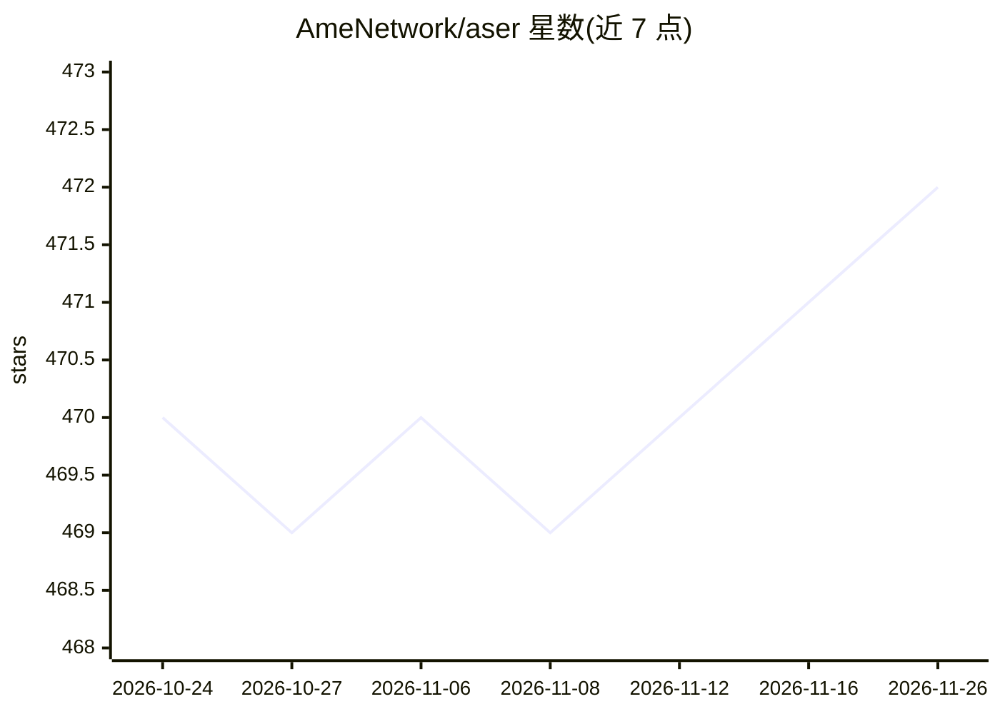

# AmeNetwork/aser

⭐ 472 · Python · MIT · 推送 2026-10-30 · [GitHub](https://github.com/AmeNetwork/aser) · [官网](https://ame.network/) · 组织维护 · 中文 README

**轻量模块化 AI Agent 框架：几行代码组装智能体**

Aser 是一个模块化的 AI Agent 构建框架，通过 Agent 类以少量代码即可组装具备记忆、RAG、工具调用、CoT 推理等能力的智能体。支持多模型配置（通过 base URL 与 key 环境变量接入），提供 API server、CLI、UI 三种交互方式，以及 Discord/Telegram/Farcaster 客户端集成。多智能体编排覆盖路由、串行、并行、反应式与分层五种模式；进阶部分提供 MCP、A2A 协议集成与实验性的 ERC8004 链上能力。以 pip 包形式发布，MIT 许可。

## 筛选速览

| 维度 | 判定 | 备注 |
|---|---|---|
| AI 角色 | `ai-ecosystem` | LLM/agent 周边工具 |
| 许可风险 | `permissive` | MIT |
| 部署形态 | `library` | 以包/库形式分发 |
| 模型依赖 | — | README 未给出锁定关系 |
| 硬件要求 | — | 无带数字的原话,不猜 |
| 安装摩擦 | `low` | 无编译、无系统依赖或容器化 |
| 成熟度 | — | 结构信号不足 |

## 能力要点

- 几行代码即可组装 Agent，支持记忆/RAG/工具/CoT 配置
- 五种多智能体编排模式（路由/串行/并行/反应式/分层）
- 提供 API server、CLI、UI 及 Discord/Telegram/Farcaster 客户端
- 支持 MCP 与 Google A2A 协议集成，含自编码工具与 ERC8004 实验特性

## 适用场景

- 快速搭建带记忆和知识检索的个人 AI 助手
- 编排多 Agent 协作完成复杂任务
- 将 Agent 接入 Discord/Telegram 等社交平台
- 通过 Text2SQL、Workflow 构建业务智能体

## 场景标签

`Agent 框架` `多智能体` `RAG` `数据分析` · 领域:Agent 开发

## 证据(README 行号)

> L3: Aser is a minimalist, modular, and versatile AI agent framework. You can assemble an agent with just a few lines of 
> L40: agent=Agent(name="aser agent",model="gpt-4.1-mini")

## 星数曲线

2026-10-24 470 → 2026-11-26 472（+2）

---
*卡片 v1 · prompt 1.4 · 生成 2026-11-25 · 置信度 high · 依据 README sha `27e22b3a3fe9` · [字段定义](../../DATASET.md)*
