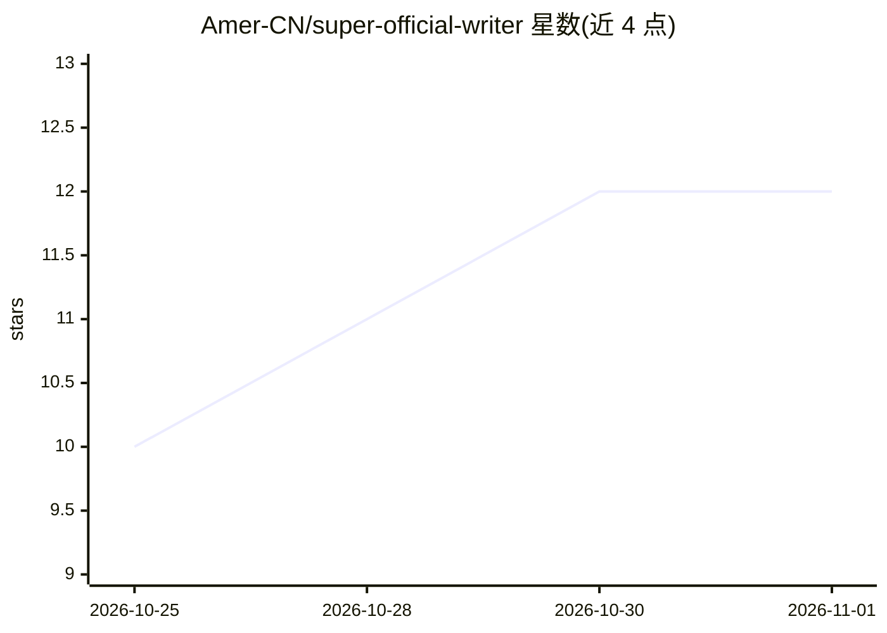

# Amer-CN/super-official-writer

⭐ 12 · Python · 推送 2026-09-17 · [GitHub](https://github.com/Amer-CN/super-official-writer) · 个人维护 · 中文 README

**装进 Agent 的中文公文写作技能：知识库+国标 Word 排版**

面向公文/材料写作者的 Agent Skills 技能包：把写作流程拆为五步法，在每步接入规则引擎与 1855 条结构化知识库（蒸馏自 7 位博主 720 期视频、17 本书与 27 份政府工作报告），支持 21 种文体框架、15 法定文种+60 事务文种规范、核稿十查、量化文风参数自检。交付层用 render_docx.js 把结构化 JSON 渲染成符合 GB/T 9704-2012 的 .docx，并有 Protected Spans 机制保护用户数据零篡改。兼容 Claude Code/Codex 等 Agent Skills 环境，也可将 SKILL.md 与 references/ 塞入任意 LLM 的 system prompt 或 RAG 知识库。

## 筛选速览

| 维度 | 判定 | 备注 |
|---|---|---|
| AI 角色 | `ai-knowledge` | 知识聚合/清单类 |
| 许可风险 | `none` | — |
| 部署形态 | `None` |  |
| 模型依赖 | — | README 未给出锁定关系 |
| 硬件要求 | — | 无带数字的原话,不猜 |
| 安装摩擦 | `low` | 无编译、无系统依赖或容器化 |
| 成熟度 | — | 结构信号不足 |

## 能力要点

- 五步写作流程接入 1855 条结构化知识（48 分类）
- render_docx.js 将结构化 JSON 渲染为 GB/T 9704-2012 国标 docx
- 7 文种 13 项文风参数量化验收与自检脚本 check_params.py
- Protected Spans 用户数据零篡改机制

## 适用场景

- 让 Agent 按五步法起草汇报、总结、讲话稿等公文材料
- 把写好的稿子交给 Agent 做核稿十查与文风参数自检
- 将 SKILL.md 与知识库文件接入任意 LLM 作为公文写作系统知识

## 场景标签

`AI 写作` `知识库管理` · 领域:内容生成

## 证据(README 行号)

> L12: 一个装进 Agent 的"笔杆子"。把公文写作拆成五步流程，在每一步接入规则引擎与知识库：写什么查什么、卡在哪查哪、写完自查什么。不是聊天式"帮我写个通知"，而是**可检索、可校验、可交付 Word** 的完整写作系统。Claud
> L21: |📚 **实战知识库**|1855 条蒸馏知识单元（48 分类 + 领域素材层 + 法定公文成稿范例层 + 报告蒸馏层 + 十七书蒸馏层 + 七博主层（v0.3 凌云+惠水 → v0.5 摆渡+捉刀人 → v0.8 改稿室 → v
> L66: > 视频类内容经授权渠道下载 → 语音转写 → 逐条蒸馏 → 结构化整理；书籍类内容经微信读书导出蒸馏。结构化数据集（1919 条 jsonl）另存。

## 星数曲线

2026-10-25 10 → 2026-11-01 12（+2）

---
*卡片 v1 · prompt 1.4 · 生成 2026-11-01 · 置信度 high · 依据 README sha `886aea467e70` · [字段定义](../../DATASET.md)*
