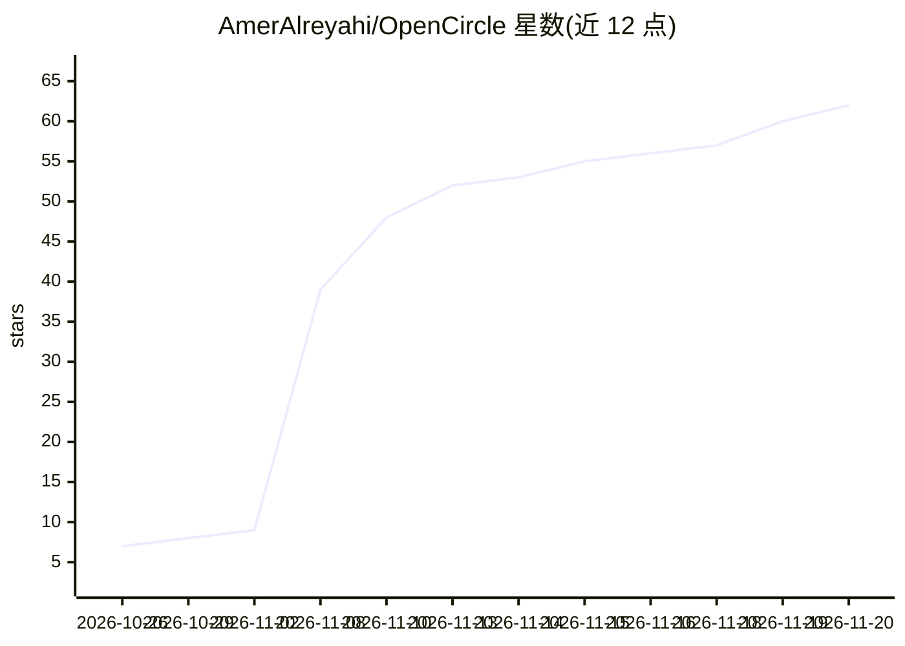

# AmerAlreyahi/OpenCircle

⭐ 62 · Rust · MIT · 推送 2026-11-19 · [GitHub](https://github.com/AmerAlreyahi/OpenCircle) · [官网](https://ameralreyahi.com/projects/opencircle) · 个人维护

**Windows/Linux 屏幕圈选工具：圈选即搜索、就地翻译、问 AI、截图标注**

用 Rust 编写的原生桌面程序，把圈选搜索、屏幕文字读取（OCR）、整屏就地翻译、AI 问答与截图标注聚合到快捷键和一条底部工具栏上。翻译默认在本地离线运行（一次性下载模型，51 个直接语言对，含阿拉伯语直连模型），支持每游戏术语表；AI 问答默认免密钥经浏览器走 Google Lens/AI Mode，也可自带 key 在应用内与 OpenRouter、OpenAI、Ollama 等对话。声明无账号、无遥测，MIT 许可。

## 筛选速览

| 维度 | 判定 | 备注 |
|---|---|---|
| AI 角色 | `ai-enhanced` | 去掉 AI 部分产品仍成立 |
| 许可风险 | `permissive` | MIT |
| 部署形态 | `desktop` | 安装包/桌面程序 |
| 模型依赖 | local-ok | 支持本地模型 |
| 硬件要求 | — | 无带数字的原话,不猜 |
| 安装摩擦 | `medium` | 含编译或系统依赖之一 |
| 成熟度 | `idea` | |

## 能力要点

- 圈选/框选后选择搜索、复制文字、翻译或问 AI，未选择前不上传
- 整屏就地翻译针对游戏优化：文字按原位重绘、适配按钮大小，默认离线运行
- AI 问答支持 OpenRouter/OpenAI/Anthropic/Gemini/Groq/Mistral/DeepSeek/xAI/Ollama/LM Studio/自建服务器
- 截图标注含长截图拼接、Blur 遮蔽、编号步骤等，密钥存于系统 keyring

## 适用场景

- 玩游戏时把整屏界面就地翻译成我的语言
- 圈选屏幕上任何内容直接搜索或问 AI
- 截屏、打码并标注后保存或分享

## 场景标签

`OCR` `图像视频处理` · 领域:感知与多模态

## 证据(README 行号)

> L9: OpenCircle is one small native program for Windows and Linux that puts search,
> L49: - **Translate in place, built for games.** Press `Alt+Shift+T` to translate the

## 星数曲线

2026-10-26 7 → 2026-11-20 62（+55）

---
*卡片 v1 · prompt 1.4 · 生成 2026-11-18 · 置信度 high · 依据 README sha `69cedb13d2f5` · [字段定义](../../DATASET.md)*
