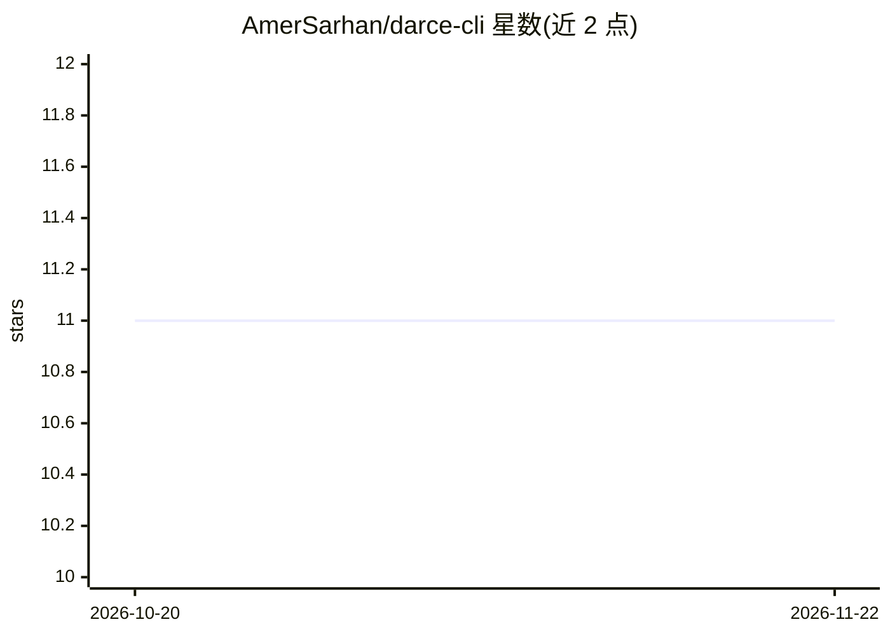

# AmerSarhan/darce-cli

⭐ 11 · TypeScript · MIT · 推送 2026-11-13 · [GitHub](https://github.com/AmerSarhan/darce-cli) · [官网](https://darce.dev) · 个人维护

**终端里的 AI 编码代理：执行可整体撤销，250+ 模型可选**

面向终端的开发者编码代理，通过 npm 安装后以 CLI 运行：写代码、执行 shell 命令，且每步前对项目快照，/undo 能回滚包括 rm、mv、npm install 等命令造成的改动，/rewind 可回到任一时点。内置模型选择器接入 OpenRouter 的 250+ 模型，支持 /derby 多模型赛跑与 /swarm 多 worktree 并行子代理合并；另有 /taste 生成感 UI 检查、/brain 项目实时依赖图、审批分级与凭据环境变量屏蔽等安全机制。免费试用一周 Builder 后按用量计费，也可用自有 OpenRouter key。

## 筛选速览

| 维度 | 判定 | 备注 |
|---|---|---|
| AI 角色 | `ai-native` | 本体是模型或模型工具 |
| 许可风险 | `permissive` | MIT |
| 部署形态 | `library` | 以包/库形式分发 |
| 模型依赖 | locked-api |  |
| 硬件要求 | — | 无带数字的原话,不猜 |
| 安装摩擦 | `low` | 无编译、无系统依赖或容器化 |
| 成熟度 | — | 结构信号不足 |

## 能力要点

- 每步快照使 /undo 可回滚 shell 命令造成的一切改动
- /derby 多模型在同一任务上赛跑，/swarm 多代理并行后一步合并
- 四级审批模式（auto/ask/plan/full）与凭据类环境变量隔离
- SKILL.md 技能目录，兼容读取 Claude Code 已有技能

## 适用场景

- 让 AI 代理改代码但保留随时整体撤销的能力
- 同一任务在多个模型间对比选出最佳结果
- 把大任务拆给多个并行代理并自动合并

## 场景标签

`编码 Agent` `多智能体` · 领域:Agent 开发

## 证据(README 行号)

> L6:  An open-source AI agent for your terminal. It writes code and runs commands with 250+ models,
> L43: **🧠 Any top model, one account, no API keys.** Claude, GPT, Gemini, Qwen, DeepSeek, Kimi, GLM, Grok and 240 more, f

## 星数曲线

2026-10-20 11 → 2026-11-22 11（+0）

---
*卡片 v1 · prompt 1.4 · 生成 2026-11-19 · 置信度 high · 依据 README sha `b113dc03b78c` · [字段定义](../../DATASET.md)*
