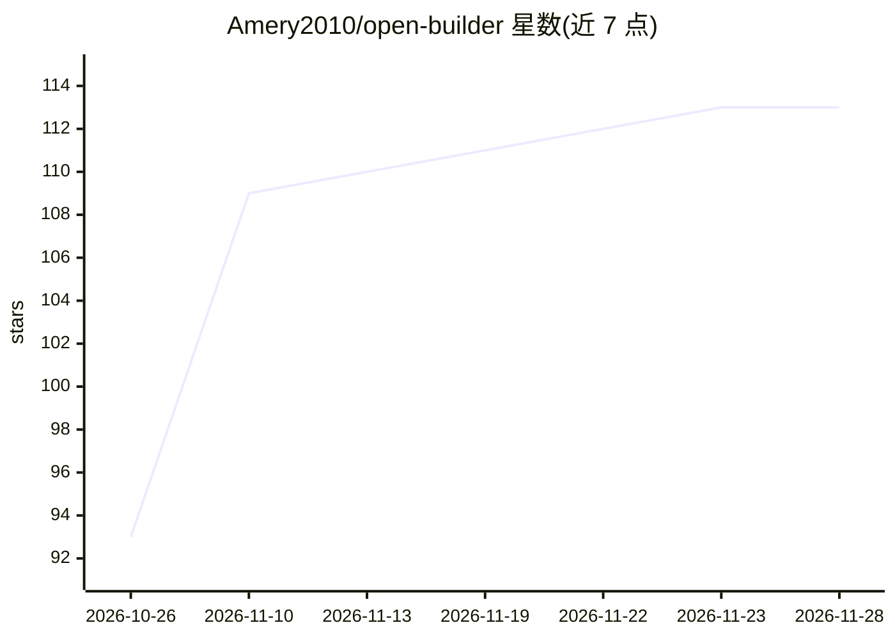

# Amery2010/open-builder

⭐ 113 · TypeScript · GPL-3.0 · 推送 2026-11-09 · [GitHub](https://github.com/Amery2010/open-builder) · [官网](https://builder.u14.app) · 个人维护 · 中文 README

**开源 AI 网页应用生成器：对话式构建、编辑与预览**

开源的 AI 网页应用工作区，通过自然语言对话生成、编辑与预览 web 应用，支持 Code/Plan/Design 三种构建模式、20+ 框架模板、36 套设计系统、项目快照分支与导出。模型由用户自行配置（OpenAI、Anthropic、Google 或兼容 API），无官方后端，历史与设置存储在本地；提供 Web、Tauri 桌面端与实验性移动端，桌面端额外支持本地 CLI、stdio MCP 与 Skill 脚本，并可将任务委派给 subagent。

## 筛选速览

| 维度 | 判定 | 备注 |
|---|---|---|
| AI 角色 | `ai-native` | 本体是模型或模型工具 |
| 许可风险 | `viral` | GPL-3.0 |
| 部署形态 | `self-host` | docker 或自建部署 |
| 模型依赖 | — | README 未给出锁定关系 |
| 硬件要求 | — | 无带数字的原话,不猜 |
| 安装摩擦 | `low` | 无编译、无系统依赖或容器化 |
| 成熟度 | — | 结构信号不足 |

## 能力要点

- 自然语言对话生成、编辑并实时预览 web 应用（20+ 框架模板、36 套设计系统）
- 自带模型：支持 OpenAI、Anthropic、Google 及兼容 API，桌面端支持 Codex/Claude 等本地 CLI
- 无官方后端，历史与设置本地存储，模型请求走用户配置的服务
- 支持 MCP 服务器、Skills、联网搜索与 subagent 协作

## 适用场景

- 用对话方式快速生成并预览一个网页应用原型
- 在浏览器或桌面端编辑现有项目并导出 ZIP 部署
- 连接 MCP 服务器与 Skills 扩展构建流程

## 场景标签

`代码生成` · 领域:编码与开发

## 证据(README 行号)

> L13: Open Builder is an open-source workspace for generating, editing, and previewing web apps with AI. Bring your own m
> L23: - **Your choice of models** — Use OpenAI, Anthropic, Google, or compatible APIs; desktop also supports Codex, Claud

## 星数曲线

2026-10-26 93 → 2026-11-28 113（+20）

---
*卡片 v1 · prompt 1.4 · 生成 2026-11-28 · 置信度 mid · 依据 README sha `c4afc9d27052` · [字段定义](../../DATASET.md)*
