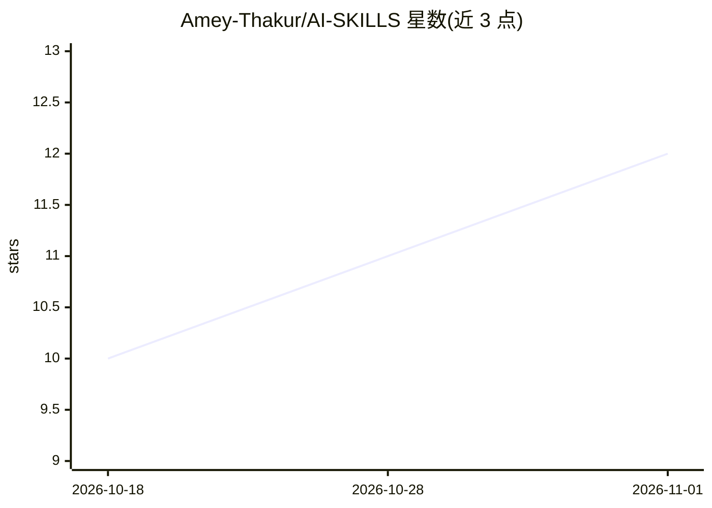

# Amey-Thakur/AI-SKILLS

⭐ 12 · JavaScript · MIT · 推送 2026-09-06 · [GitHub](https://github.com/Amey-Thakur/AI-SKILLS) · [官网](https://amey-thakur.github.io/AI-SKILLS/) · 个人维护

**面向 AI 编码代理的技能与提示词即插即用库**

由两部分组成：一是为 Claude Code、Cursor、Gemini CLI、Copilot 等编码代理编写的原创技能（SKILL.md 格式）与 250 条提示词，覆盖 70 余个类别（代码审查、调试、安全、多代理协作等）；二是通过 ecosystem.json 索引 GitHub 上其他主要技能集合，共 8,000+ 条可达。条目为纯 markdown 加少量 YAML，任何能读文件的代理均可加载，Claude Code 可通过插件市场一键安装；index.json/llms.txt 提供机器可读目录，代理可按 use_when 触发条件自主选用。MIT 许可，允许商用。

## 筛选速览

| 维度 | 判定 | 备注 |
|---|---|---|
| AI 角色 | `ai-knowledge` | 知识聚合/清单类 |
| 许可风险 | `permissive` | MIT |
| 部署形态 | `None` |  |
| 模型依赖 | locked-api |  |
| 硬件要求 | — | 无带数字的原话,不猜 |
| 安装摩擦 | `medium` | 含编译或系统依赖之一 |
| 成熟度 | — | 结构信号不足 |

## 能力要点

- 原创技能库按 70+ 类别组织，另有 250 条提示词
- ecosystem.json 索引 8,000+ 外部技能
- 纯 markdown 格式，Claude Code 可插件市场一键安装
- index.json/llms.txt 机器可读目录，代理可自主选择技能

## 适用场景

- 为我的编码代理配置代码审查、调试等可复用方法
- 在 Claude Code 中把提示词装成斜杠命令
- 让代理从 index.json 自选所需技能

## 场景标签

`提示工程` `精选清单` · 领域:Agent 开发

## 证据(README 行号)

> L30: One place that finds every skill. Two halves make that true:
> L34: - **The ecosystem index**: every major skill collection on
> L35:  GitHub, indexed with per-skill links for the official ones. 8,000+ skills

## 星数曲线

2026-10-18 10 → 2026-11-01 12（+2）

---
*卡片 v1 · prompt 1.4 · 生成 2026-11-01 · 置信度 high · 依据 README sha `086346a7fac0` · [字段定义](../../DATASET.md)*
