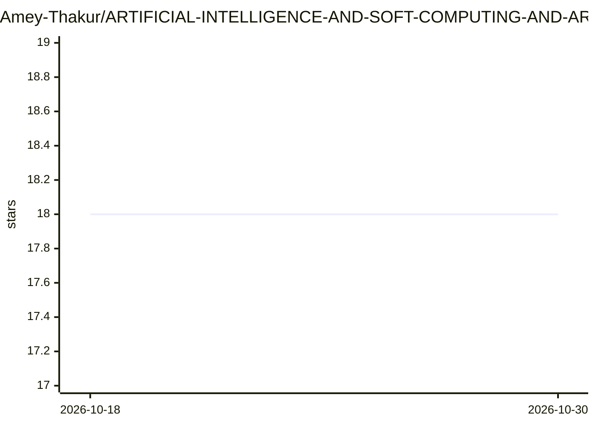

# Amey-Thakur/ARTIFICIAL-INTELLIGENCE-AND-SOFT-COMPUTING-AND-ARTIFICIAL-INTELLIGENCE-AND-SOFT-COMPUTING-LAB

⭐ 18 · C · CC-BY-4.0 · 推送 2026-09-05 · [GitHub](https://github.com/Amey-Thakur/ARTIFICIAL-INTELLIGENCE-AND-SOFT-COMPUTING-AND-ARTIFICIAL-INTELLIGENCE-AND-SOFT-COMPUTING-LAB) · [官网](https://github.com/Amey-Thakur/COMPUTER-ENGINEERING) · 个人维护

**孟买大学 AI 与软计算课程的本科学习资料归档**

个人维护的课程资料仓库，收录 University of Mumbai 计算机工程第七学期 CSC703/CSL703（人工智能与软计算及实验）的模块笔记、参考书目、作业、测验、试卷与 10 个实验室实验（PROLOG 家族树、BFS/DFS、A* 搜索、Weka 花卉分类、模糊关系、模糊控制器、McCulloch Pitts 神经元、Kohonen SOM 等）。另含一个 Neuro-Fuzzy 案例研究，其论文发表于 IJRASET 并在 viXra 提供预印本。材料为 2018-2022 本科期间完成，许可为 CC BY 4.0。仓库本身不提供安装命令，实验需自备 SWI-Prolog、C/C++ 编译器与 MATLAB/Python 环境。

## 筛选速览

| 维度 | 判定 | 备注 |
|---|---|---|
| AI 角色 | `ai-knowledge` | 知识聚合/清单类 |
| 许可风险 | `viral` | CC-BY-4.0 |
| 部署形态 | `None` |  |
| 模型依赖 | — | README 未给出锁定关系 |
| 硬件要求 | — | 无带数字的原话,不猜 |
| 安装摩擦 | `low` | 无编译、无系统依赖或容器化 |
| 成熟度 | — | 结构信号不足 |

## 能力要点

- 6 个课程模块的笔记与参考书目（搜索、知识表示、神经网络、模糊逻辑、遗传算法等）
- 10 个实验室实验含代码：PROLOG、C、Python、MATLAB、Weka 多语言实现
- Neuro-Fuzzy 案例研究论文发表于 IJRASET（卷 9 期 9）并有 viXra 预印本
- 收录 2012-2019 年大学试卷、作业、测验与考试答卷

## 适用场景

- 复习 AI 与软计算课程的搜索算法、神经网络与模糊逻辑内容
- 参考各语言实现的经典 AI 实验代码
- 查阅孟买大学历年试卷与实验题目

## 场景标签

`教程课程` · 领域:学习与行业

## 证据(README 行号)

> L12:  **A comprehensive academic resource for Artificial Intelligence and Soft Computing (AISC) and AISC Laboratory, cov
> L33: This repository represents a curated collection of study materials, reference books, lab experiments, and personal 

## 星数曲线

2026-10-18 18 → 2026-10-30 18（+0）

---
*卡片 v1 · prompt 1.4 · 生成 2026-10-29 · 置信度 high · 依据 README sha `e0c3ecec538a` · [字段定义](../../DATASET.md)*
