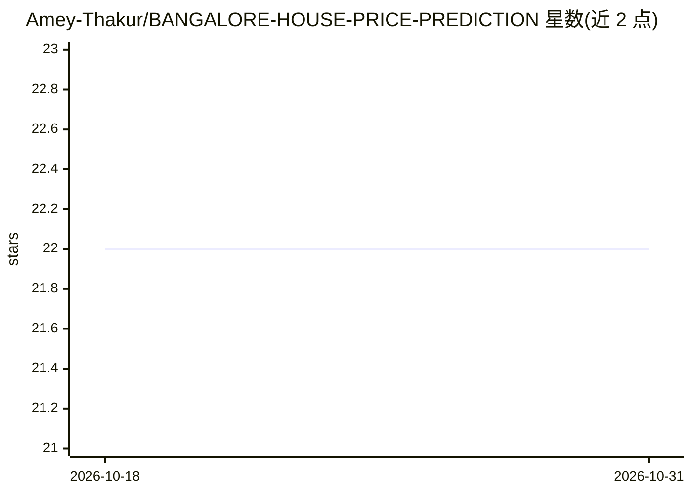

# Amey-Thakur/BANGALORE-HOUSE-PRICE-PREDICTION

⭐ 22 · Python · MIT · 推送 2026-09-05 · [GitHub](https://github.com/Amey-Thakur/BANGALORE-HOUSE-PRICE-PREDICTION) · [官网](https://huggingface.co/spaces/ameythakur/Bangalore-House-Price-Prediction) · 个人维护

**用多元回归预测班加罗尔房价的 Flask 机器学习项目**

在 IIT ROPAR - Diginique Techlabs 暑期实习期间完成的机器学习研究项目：基于班加罗尔房产数据集（位置、面积、BHK、卫浴数），使用 Scikit-learn 训练 Linear/Lasso/Ridge 回归模型估计房价，含数据清洗、独热编码降维与离群值处理；模型经 Pickle 序列化后由 Flask Web 服务器提供实时估价界面。项目以 IRJET 论文形式发表并附 viXra 预印本，提供 Kaggle Notebook 与 Hugging Face Space 在线演示，面向学生与教学场景。README 建议随市场变化定期重训模型。

## 筛选速览

| 维度 | 判定 | 备注 |
|---|---|---|
| AI 角色 | `ai-native` | 本体是模型或模型工具 |
| 许可风险 | `permissive` | MIT |
| 部署形态 | `None` |  |
| 模型依赖 | — | README 未给出锁定关系 |
| 硬件要求 | — | 无带数字的原话,不猜 |
| 安装摩擦 | `low` | 无编译、无系统依赖或容器化 |
| 成熟度 | — | 结构信号不足 |

## 能力要点

- Linear/Lasso/Ridge 三种回归对比，以 RMSE 最小化选型
- 独热编码处理高基数位置特征与离群值剔除
- Pickle 序列化模型，Flask Web 实时估价
- 附带 Kaggle Notebook、论文与 Hugging Face Space 演示

## 适用场景

- 输入位置/面积/BHK 估计班加罗尔房价
- 学习多元回归、独热编码与离群值检测流程
- 作为数据科学课程的实验示例

## 场景标签

`教程课程` · 领域:学习与行业

## 证据(README 行号)

> L8:  A machine learning study demonstrating the application of **Multivariate Regression** algorithms to estimate real e
> L31: By leveraging **Scikit-learn**, the system models the real estate landscape where an algorithm learns the relations
> L108:  Real-time price estimation based on the trained regression model.

## 星数曲线

2026-10-18 22 → 2026-10-31 22（+0）

---
*卡片 v1 · prompt 1.4 · 生成 2026-10-28 · 置信度 high · 依据 README sha `a6f4b94c74ad` · [字段定义](../../DATASET.md)*
