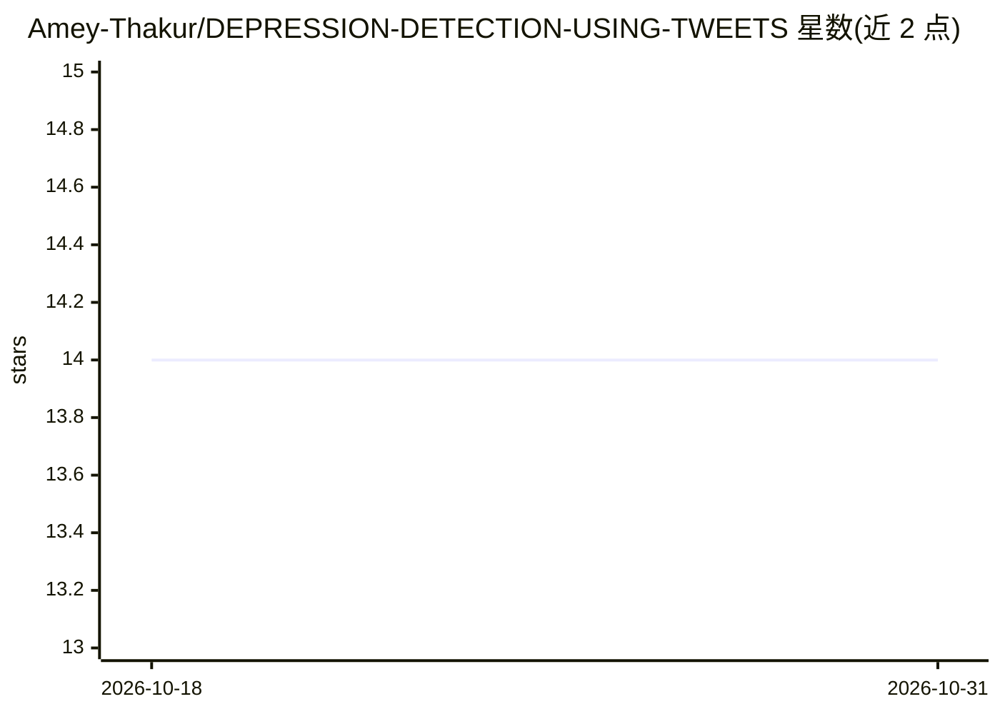

# Amey-Thakur/DEPRESSION-DETECTION-USING-TWEETS

⭐ 14 · Jupyter Notebook · MIT · 推送 2026-09-05 · [GitHub](https://github.com/Amey-Thakur/DEPRESSION-DETECTION-USING-TWEETS) · [官网](https://huggingface.co/spaces/ameythakur/Depression-Detection-Using-Tweets) · 个人维护

**基于 SVM+spaCy 的推文抑郁情绪二分类 Web 应用**

Python+Flask 的机器学习应用：读取用户输入的推文文本，经 spaCy（en_core_web_lg）NLP 预处理与 TF-IDF 向量化后，用 SVM 模型输出抑郁倾向的二分类预测，并通过 Flask 网页界面实时展示结果。面向学生、教育者与研究人员，作为学习 SVM、spaCy 管线与 Flask 模型部署的教学参考项目。安装需克隆仓库、建虚拟环境、pip 安装依赖并下载约 800MB 的 spaCy 模型（需约 2GB 可用内存），另提供 Hugging Face Space 在线演示。

## 筛选速览

| 维度 | 判定 | 备注 |
|---|---|---|
| AI 角色 | `ai-native` | 本体是模型或模型工具 |
| 许可风险 | `permissive` | MIT |
| 部署形态 | `library` | 以包/库形式分发 |
| 模型依赖 | — | README 未给出锁定关系 |
| 硬件要求 | — | 无带数字的原话,不猜 |
| 安装摩擦 | `low` | 无编译、无系统依赖或容器化 |
| 成熟度 | — | 结构信号不足 |

## 能力要点

- SVM + TF-IDF 对推文做抑郁情绪二分类
- spaCy en_core_web_lg 深度语言学预处理（词形还原、停用词过滤）
- Flask 实时推理网页界面
- 提供 Hugging Face Space 在线演示

## 适用场景

- 在网页中输入推文文本获取抑郁倾向分类结果
- 学生学习 SVM、spaCy NLP 管线与 Flask 模型部署的参考实现
- 作为数据科学/NLP 课程的教学实验案例

## 场景标签

 · 领域:NLP/心理健康监测

## 证据(README 行号)

> L8:  A modern **Python** + **Flask** application designed to analyze tweet sentiment and predict depressive characterist
> L28: * **Vector-Space Inference**: By leveraging **Support Vector Machines (SVM)** and **TF-IDF vectorization**, the mod

## 星数曲线

2026-10-18 14 → 2026-10-31 14（+0）

---
*卡片 v1 · prompt 1.4 · 生成 2026-10-31 · 置信度 high · 依据 README sha `7ec5f6971d1f` · [字段定义](../../DATASET.md)*
