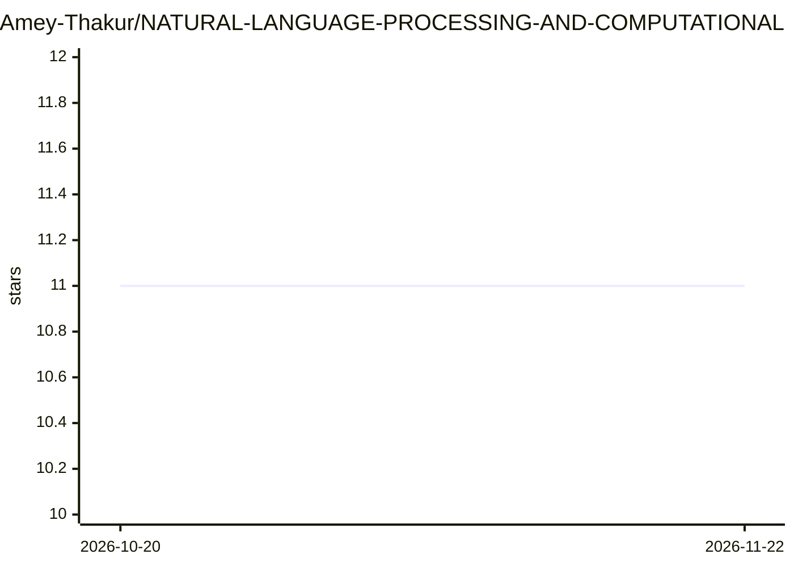

# Amey-Thakur/NATURAL-LANGUAGE-PROCESSING-AND-COMPUTATIONAL-LAB-II

⭐ 11 · Python · CC-BY-4.0 · 推送 2026-09-05 · [GitHub](https://github.com/Amey-Thakur/NATURAL-LANGUAGE-PROCESSING-AND-COMPUTATIONAL-LAB-II) · [官网](https://github.com/Amey-Thakur/COMPUTER-ENGINEERING) · 个人维护

**孟买大学 NLP 与计算实验 II 课程资料库：为学习者整理学习材料**

孟买大学计算机工程第八学期 DLO8012（自然语言处理）与 CSL804（计算实验 II）课程的资料集合，由作者在本科期间（2018-2022）编写整理。内容包含参考书目、模块化笔记、作业、10 个实验（词分析、词干化、N-gram、平滑、POS 标注、Viterbi、形态分析、组块分析、语义分析）的 Python 程序与 Kaggle Notebook、试题与题库、教学大纲及提交报告。

## 筛选速览

| 维度 | 判定 | 备注 |
|---|---|---|
| AI 角色 | `ai-knowledge` | 知识聚合/清单类 |
| 许可风险 | `viral` | CC-BY-4.0 |
| 部署形态 | `None` |  |
| 模型依赖 | — | README 未给出锁定关系 |
| 硬件要求 | — | 无带数字的原话,不猜 |
| 安装摩擦 | `low` | 无编译、无系统依赖或容器化 |
| 成熟度 | — | 结构信号不足 |

## 能力要点

- 涵盖 N-gram、HMM、CFG 等课程主题的模块化笔记与参考书清单
- 10 个实验的 Python 程序与配套 Kaggle Notebook
- 含作业、内部测评、期末试题、口试题库与答案
- 提供 IIIT Hyderabad Virtual Lab 实验补充入口

## 适用场景

- 复习孟买大学 NLP 课程的考试题目与笔记
- 参考 Python 实现学习 N-gram、Viterbi 等基础算法
- 查找该课程大纲与考核材料

## 场景标签

`教程课程` · 领域:学习与行业

## 证据(README 行号)

> L33: This repository represents a curated collection of study materials, reference books, lab experiments, and personal 
> L131: The laboratory component (CSL804) focuses on implementing NLP algorithms and techniques using Python.

## 星数曲线

2026-10-20 11 → 2026-11-22 11（+0）

---
*卡片 v1 · prompt 1.4 · 生成 2026-11-19 · 置信度 high · 依据 README sha `184b484df769` · [字段定义](../../DATASET.md)*
