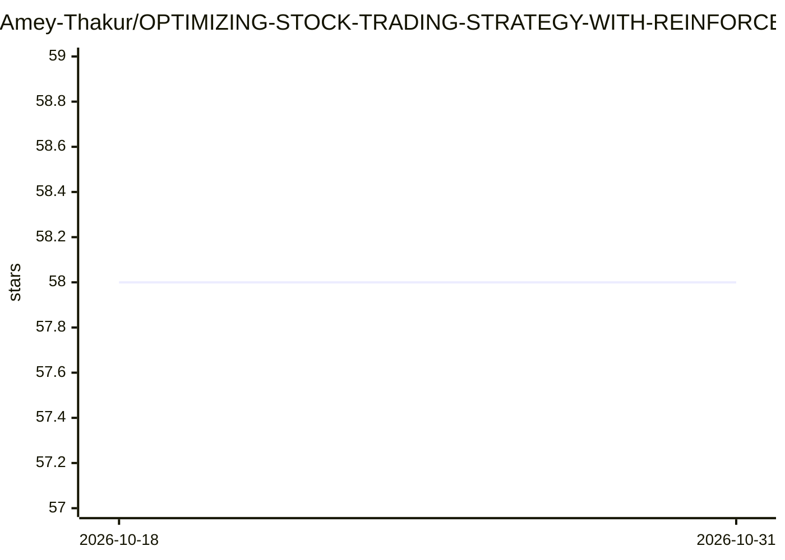

# Amey-Thakur/OPTIMIZING-STOCK-TRADING-STRATEGY-WITH-REINFORCEMENT-LEARNING

⭐ 58 · Python · MIT · 推送 2026-09-05 · [GitHub](https://github.com/Amey-Thakur/OPTIMIZING-STOCK-TRADING-STRATEGY-WITH-REINFORCEMENT-LEARNING) · [官网](https://huggingface.co/spaces/ameythakur/Stock-Trading-RL) · 组织维护

**用 Q-Learning 强化学习优化股票交易策略的教学型数据科学项目**

数据科学实习期间完成的强化学习研究项目：以 5 日与 1 日移动平均交叉定义市场状态，Q-Learning 智能体在离散动作空间（买/卖/持有）中通过 Epsilon-Greedy 策略学习交易决策，动态跟踪现金、持仓与净值；成果以 Streamlit + Plotly 交互式仪表盘可视化，并附 Kaggle Notebook、技术报告与 Hugging Face Space 在线演示。README 明确说明其以教学清晰度优先，简化了状态空间，非高频交易复杂度，并建议定期用新数据重训。

## 筛选速览

| 维度 | 判定 | 备注 |
|---|---|---|
| AI 角色 | `ai-native` | 本体是模型或模型工具 |
| 许可风险 | `permissive` | MIT |
| 部署形态 | `None` |  |
| 模型依赖 | — | README 未给出锁定关系 |
| 硬件要求 | — | 无带数字的原话,不猜 |
| 安装摩擦 | `low` | 无编译、无系统依赖或容器化 |
| 成熟度 | — | 结构信号不足 |

## 能力要点

- Q-Learning 智能体基于移动平均交叉状态做买/卖/持有决策
- Streamlit + Plotly 交互式仪表盘展示趋势、净值增长与波动分析
- 提供 Kaggle Notebook、技术报告与 Hugging Face Space 在线演示
- 动态跟踪现金、持仓与总净值的组合管理逻辑

## 适用场景

- 学习 Q-Learning、状态离散化与金融奖励设计等概念
- 作为计算金融/AI/量化交易课程的教学实验示例
- 在浏览器中交互模拟强化学习交易策略的组合表现

## 场景标签

`金融量化` `教程课程` · 领域:学习与行业

## 证据(README 行号)

> L8:  A machine learning study demonstrating the application of **Reinforcement Learning (Q-Learning)** algorithms to opt
> L67: |**RL Agent**|**Q-Learning** implementation with state-action mapping for decision autonomy.|
> L140: streamlit run Stock-RL.py

## 星数曲线

2026-10-18 58 → 2026-10-31 58（+0）

---
*卡片 v1 · prompt 1.4 · 生成 2026-10-24 · 置信度 high · 依据 README sha `a6e3acbd8ae7` · [字段定义](../../DATASET.md)*
