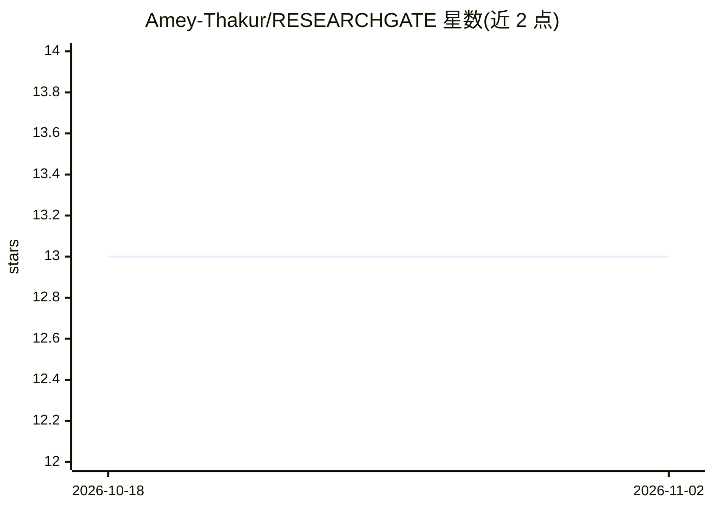

# Amey-Thakur/RESEARCHGATE

⭐ 13 · Jupyter Notebook · CC-BY-4.0 · 推送 2026-09-05 · [GitHub](https://github.com/Amey-Thakur/RESEARCHGATE) · [官网](https://www.researchgate.net/profile/Amey-Thakur) · 个人维护

**归档 ResearchGate 研究项目代码与学术产物的个人研究仓库**

Amey Thakur 维护的技术伴随仓库：以目录形式归档 12 个研究项目（Hangman 游戏、PHP 聊天室、租车数据库、数字书店、GAN 卡通化、房价预测、神经 Networks/GAN/Neuro-Fuzzy 研究、强化学习交易、文本摘要、QuadTree 可视化、Amazon Lex 聊天机器人），每个条目链接 GitHub 仓库、DOI 论文、预印本与演示。README 提供三条学习路径（AI 研究者/全栈工程师/算法可视化）与使用指引，许可为 CC BY 4.0。仓库本身为档案目录，非可安装运行的软件。

## 筛选速览

| 维度 | 判定 | 备注 |
|---|---|---|
| AI 角色 | `ai-knowledge` | 知识聚合/清单类 |
| 许可风险 | `viral` | CC-BY-4.0 |
| 部署形态 | `None` |  |
| 模型依赖 | — | README 未给出锁定关系 |
| 硬件要求 | — | 无带数字的原话,不猜 |
| 安装摩擦 | `low` | 无编译、无系统依赖或容器化 |
| 成熟度 | — | 结构信号不足 |

## 能力要点

- 12 个项目条目，各含目标、GitHub 仓库、DOI 论文与演示链接
- 三条学习路径：AI 研究、全栈系统工程、算法逻辑与可视化
- 声明所有归档条目与已发表研究同步（DOI 关联）
- CC BY 4.0 许可

## 适用场景

- 学生查阅应用机器学习、数据库与 Web 架构的参考实现
- 教师将项目用作 AI/数据科学课程的实验示例
- 研究者了解 DOI 集成与学术归档的组织方式

## 场景标签

`精选清单` · 领域:学习与行业

## 证据(README 行号)

> L12:  An authoritative technical companion and scholarly archival mirror designed to synchronize functional implementati
> L38: > This repository functions as a deterministic technical archival mirror for scholarly implementations. It synchron
> L42: **ResearchGate (Technical Archival)** is a specialized scholarly companion architecture engineered to preserve, sho

## 星数曲线

2026-10-18 13 → 2026-11-02 13（+0）

---
*卡片 v1 · prompt 1.4 · 生成 2026-10-31 · 置信度 high · 依据 README sha `25c11045d3d8` · [字段定义](../../DATASET.md)*
