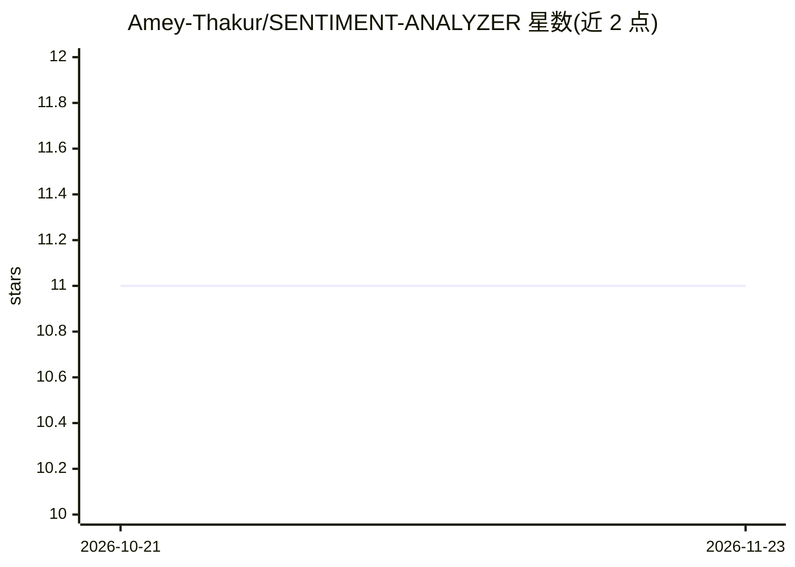

# Amey-Thakur/SENTIMENT-ANALYZER

⭐ 11 · Python · MIT · 推送 2026-09-05 · [GitHub](https://github.com/Amey-Thakur/SENTIMENT-ANALYZER) · [官网](https://amey-thakur.github.io/SENTIMENT-ANALYZER/) · 个人维护

**给学习者的规则式 NLP 文本情感量化引擎**

基于规则语言模式的 NLP 情感分析引擎：通过词汇极性线性倍增器对文本流或批量输入打分，词库引擎基于 TextBlob，并以词典过滤和概率权重展示置信度；另附独立的 Keras 分类器参考实现（不含训练权重，不参与分析路径）。经 PyScript/Pyodide 编译为 WebAssembly 在浏览器实时运行，同时提供终端界面与 GitHub Pages 在线演示，含详细注释与教学指南。

## 筛选速览

| 维度 | 判定 | 备注 |
|---|---|---|
| AI 角色 | `ai-native` | 本体是模型或模型工具 |
| 许可风险 | `permissive` | MIT |
| 部署形态 | `library` | 以包/库形式分发 |
| 模型依赖 | — | README 未给出锁定关系 |
| 硬件要求 | — | 无带数字的原话,不猜 |
| 安装摩擦 | `low` | 无编译、无系统依赖或容器化 |
| 成熟度 | — | 结构信号不足 |

## 能力要点

- 基于 TextBlob 词库的规则式极性评分引擎
- PyScript/Pyodide 实现 WebAssembly 浏览器内实时分析
- 支持文本流与批处理两种输入模式
- 附独立的 Keras 分类器参考实现（无训练权重）

## 适用场景

- 学习规则式 NLP 情感分析流水线的实现
- 作为计算机工程课程的实验或教学案例
- 在浏览器中实时演示文本情感极性量化
- 研究跨平台 WebAssembly 部署方案

## 场景标签

`教程课程` · 领域:学习与行业

## 证据(README 行号)

> L25: **Sentiment Analyzer** is a Natural Language Processing (NLP) engine designed to accurately identify and quantify s
> L32: * **Neural Reference Implementation**: A **Keras** classifier architecture is defined separately in `neural_sentime

## 星数曲线

2026-10-21 11 → 2026-11-23 11（+0）

---
*卡片 v1 · prompt 1.4 · 生成 2026-11-19 · 置信度 high · 依据 README sha `d1bb5b43292b` · [字段定义](../../DATASET.md)*
