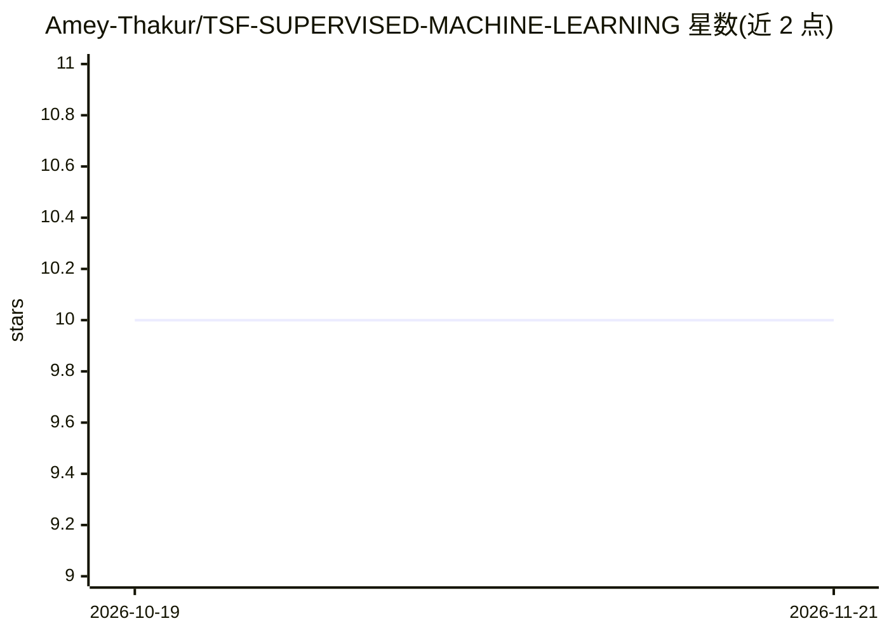

# Amey-Thakur/TSF-SUPERVISED-MACHINE-LEARNING

⭐ 10 · Python · MIT · 推送 2026-09-05 · [GitHub](https://github.com/Amey-Thakur/TSF-SUPERVISED-MACHINE-LEARNING) · [官网](https://amey-thakur.github.io/TSF-SUPERVISED-MACHINE-LEARNING/) · 个人维护

**学生按学习时长预测成绩的线性回归教学项目**

The Sparks Foundation GRIP 实习项目（Task 1），用 Scikit-Learn 的 LinearRegression 实现 OLS 单变量线性回归，根据每日学习小时数预测学生分数。流程包括 Pandas 远程数据读取、Matplotlib/Seaborn 探索性分析、模型训练与 MAE/R² 评估，并以 Jupyter Notebook 形式提供，另附 Google Colab、Kaggle Notebook 与在线演示入口。README 提示模型外推超出数据范围时结果不可靠，且要求数据文件保持相对路径不变。

## 筛选速览

| 维度 | 判定 | 备注 |
|---|---|---|
| AI 角色 | `ai-knowledge` | 知识聚合/清单类 |
| 许可风险 | `permissive` | MIT |
| 部署形态 | `library` | 以包/库形式分发 |
| 模型依赖 | — | README 未给出锁定关系 |
| 硬件要求 | — | 无带数字的原话,不猜 |
| 安装摩擦 | `low` | 无编译、无系统依赖或容器化 |
| 成熟度 | — | 结构信号不足 |

## 能力要点

- Scikit-Learn LinearRegression 实现 OLS 回归
- MAE 与 R² 评估（MAE 4.18，R² 0.945）
- Pandas 自动从远程 HTTP 端点读取数据
- 提供 Colab/Kaggle Notebook 与在线演示入口

## 适用场景

- 作为监督学习与单变量回归的学习参考材料
- 数据科学课程中的实验示例或教学资源
- 复现实习任务中的成绩预测分析流程

## 场景标签

`教程课程` · 领域:学习与行业

## 证据(README 行号)

> L27: **Supervised Machine Learning - Task 1** is a foundational Data Science exploration conducted under the **Graduate 
> L148: This repository is openly shared to support learning and knowledge exchange across the academic community.

## 星数曲线

2026-10-19 10 → 2026-11-21 10（+0）

---
*卡片 v1 · prompt 1.4 · 生成 2026-11-20 · 置信度 mid · 依据 README sha `afbd24196f19` · [字段定义](../../DATASET.md)*
