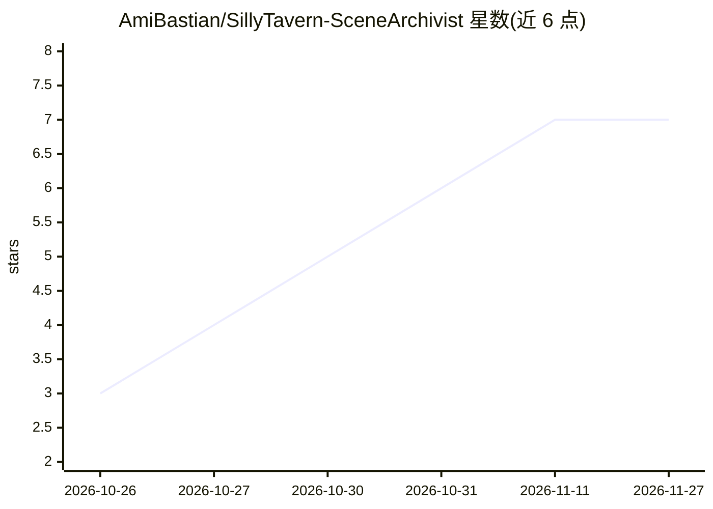

# AmiBastian/SillyTavern-SceneArchivist

⭐ 7 · JavaScript · AGPL-3.0 · 推送 2026-11-17 · [GitHub](https://github.com/AmiBastian/SillyTavern-SceneArchivist) · [官网](https://github.com/AmiBastian/SillyTavern-SceneArchivist) · 个人维护

**SillyTavern 扩展：场景摘要、角色记忆与连续性存档**

作为 SillyTavern 扩展运行，通过 SillyTavern 的 Extensions → Install extension 安装，粘贴仓库 URL 即可。功能包括：选取消息范围生成场景摘要并可逐条校对修正，为角色建立独立记忆（记录谁知晓何事）、追踪器、角色日记、Little Things 细节、recap 与记录压缩；保存到可编辑的 lorebook。用户可核对摘要与原始聊天、查看哪些记录进入了回复（Memory Trail）、以具体问题检索存档并显示所用证据。需配合 SillyTavern 的模型连接调用 LLM，输出须经用户审阅后保存。

## 筛选速览

| 维度 | 判定 | 备注 |
|---|---|---|
| AI 角色 | `ai-enhanced` | 去掉 AI 部分产品仍成立 |
| 许可风险 | `viral` | AGPL-3.0 |
| 部署形态 | `None` |  |
| 模型依赖 | — | README 未给出锁定关系 |
| 硬件要求 | — | 无带数字的原话,不猜 |
| 安装摩擦 | `low` | 无编译、无系统依赖或容器化 |
| 成熟度 | — | 结构信号不足 |

## 能力要点

- 按消息范围生成场景摘要与角色记忆，保存至可编辑 lorebook
- Memory Trail 与证据视图可核对哪些记录进入了回复
- 追踪器记录承诺/期限/秘密及知情者，支持按日期回溯知识状态
- 日记、Little Things、recap 与记录压缩（condense）功能

## 适用场景

- 长对话角色扮演中防止设定与细节被遗忘
- 让角色只记得自己亲历或被告知的信息
- 在存档中检索某个情节细节并回溯原始消息
- 为角色生成并维护第一人称日记

## 场景标签

`Agent 记忆` · 领域:Agent 开发

## 证据(README 行号)

> L5: Scene Archivist is a **SillyTavern** extension by **Mira**. It saves scenes, character memories, clues, and diaries 
> L11: 1. In SillyTavern, open **Extensions → Install extension**.

## 星数曲线

2026-10-26 3 → 2026-11-27 7（+4）

---
*卡片 v1 · prompt 1.4 · 生成 2026-11-20 · 置信度 high · 依据 README sha `1e1ef275db43` · [字段定义](../../DATASET.md)*
