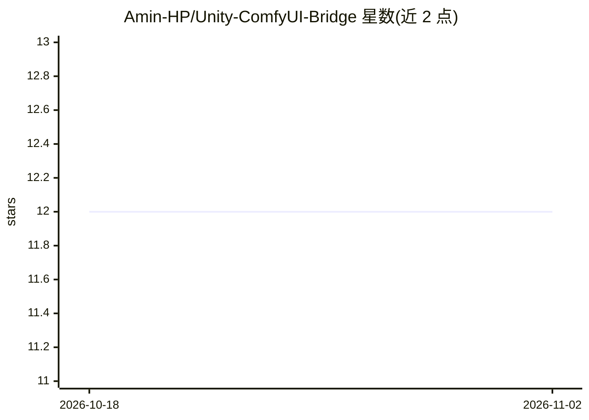

# Amin-HP/Unity-ComfyUI-Bridge

⭐ 12 · C# · MIT · 推送 2026-08-01 · [GitHub](https://github.com/Amin-HP/Unity-ComfyUI-Bridge) · 个人维护

**Unity 与 ComfyUI 的运行时桥接插件：在游戏内生成图像/音频/3D 模型**

Unity 资产形式的运行时桥接工具，通过 ComfyUI API 在游戏或应用内执行工作流，支持 Text-to-Image、Image-to-Image、Inpainting、音频生成与 GLB 3D 模型生成。核心机制：非阻塞的“即发即忘”执行队列顺序处理请求；Inspector 中的可视化节点配置映射到 ComfyUI JSON 的节点 ID；支持将 Camera 输出的 RenderTexture 作为输入上传。依赖 Newtonsoft Json 与 glTFast 包，通过拷贝文件夹或 UPM/Git 安装，MIT 许可。限制：Unity 不原生支持 FLAC 回放。

## 筛选速览

| 维度 | 判定 | 备注 |
|---|---|---|
| AI 角色 | `ai-ecosystem` | LLM/agent 周边工具 |
| 许可风险 | `permissive` | MIT |
| 部署形态 | `None` |  |
| 模型依赖 | — | README 未给出锁定关系 |
| 硬件要求 | — | 无带数字的原话,不猜 |
| 安装摩擦 | `low` | 无编译、无系统依赖或容器化 |
| 成熟度 | — | 结构信号不足 |

## 能力要点

- 单一工作流引擎覆盖图像/音频/3D 模型生成与 Inpainting
- 非阻塞运行时队列系统，多请求顺序执行不冻结游戏
- RenderTexture 可直接作为输入图像送入 ComfyUI
- Inspector 中按节点 ID 配置 Prompts、Seeds、Steps 等参数

## 适用场景

- 在 Unity 游戏或应用运行时调用 ComfyUI 生成图像、音频或 3D 模型
- 将游戏相机画面经 RenderTexture 送入 ComfyUI 做 Image-to-Image 或 Inpainting
- 在运行时动态生成并实例化 GLTF/GLB 模型

## 场景标签

`图像生成` · 领域:内容生成

## 证据(README 行号)

> L4: A robust, node-based integration tool that connects Unity to ComfyUI at runtime. This asset allows you to generate I
> L8: * **Workflow Engine:** A single component that supports Text-to-Image, Image-to-Image, Inpainting, Audio Generation,

## 星数曲线

2026-10-18 12 → 2026-11-02 12（+0）

---
*卡片 v1 · prompt 1.4 · 生成 2026-11-01 · 置信度 high · 依据 README sha `5010b75e5cb0` · [字段定义](../../DATASET.md)*
