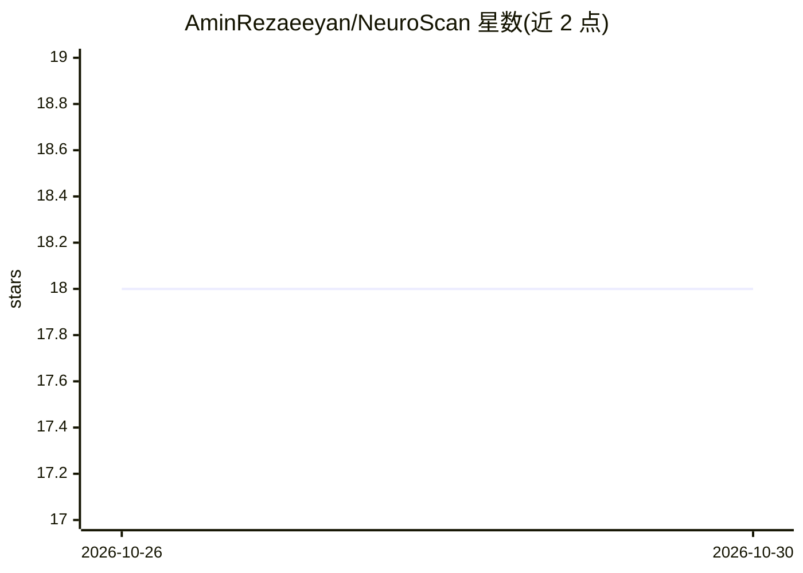

# AminRezaeeyan/NeuroScan

⭐ 18 · Python · MIT · 推送 2026-10-26 · [GitHub](https://github.com/AminRezaeeyan/NeuroScan) · 个人维护

**脑瘤 MRI 分类模型与研究演示：泄露-free 评测与安全服务**

从 2D MRI 切片分类胶质瘤、脑膜瘤、垂体瘤与无肿瘤四类。提供重复样本审计与分组切分（55% 测试图在训练集中有近重复）、MLflow 实验追踪、预注册规则的四模型对比（Baseline CNN/EfficientNetB0/ResNet50）、温度缩放校准、Mahalanobis 分布外拒判与外部医院数据验证。以 FastAPI 服务与单页演示交付，模型存于本地 MLflow registry（训练约需四个 Colab 会话），提供 Docker 容器与 CI。声明为研究演示、非医疗设备，不可用于诊断。

## 筛选速览

| 维度 | 判定 | 备注 |
|---|---|---|
| AI 角色 | `ai-native` | 本体是模型或模型工具 |
| 许可风险 | `permissive` | MIT |
| 部署形态 | `None` |  |
| 模型依赖 | — | README 未给出锁定关系 |
| 硬件要求 | — | 无带数字的原话,不猜 |
| 安装摩擦 | `medium` | 含编译或系统依赖之一 |
| 成熟度 | — | 结构信号不足 |

## 能力要点

- 重复样本检测构建无泄露训练/验证/测试切分
- 预注册规则下四模型对比，MLflow 追踪，95% 置信区间
- 温度缩放校准与 Mahalanobis 分布外拒判（照片/X 光/CT/脊柱 MRI 拒判 AUROC 0.999）
- FastAPI 服务返回 ok/uncertain/rejected_ood/rejected_input 四种状态，附 Grad-CAM 热图

## 适用场景

- 研究者复现带泄露审计与校准的医学影像分类流水线
- 演示分类服务如何对分布外输入拒判并送往人工复核
- 作为可审计机器学习实验（预注册比较、MLflow 追踪、CI）的参考实现

## 场景标签

`模型评测` `目标检测` `科研工具` · 领域:评测与运维

## 证据(README 行号)

> L7: Brain tumor classification from 2D MRI slices (glioma, meningioma, pituitary tumor, no
> L50: - **Served safely.** FastAPI service and a single-page demo, loaded from the MLflow

## 星数曲线

2026-10-26 18 → 2026-10-30 18（+0）

---
*卡片 v1 · prompt 1.4 · 生成 2026-10-29 · 置信度 high · 依据 README sha `723c9c62b313` · [字段定义](../../DATASET.md)*
