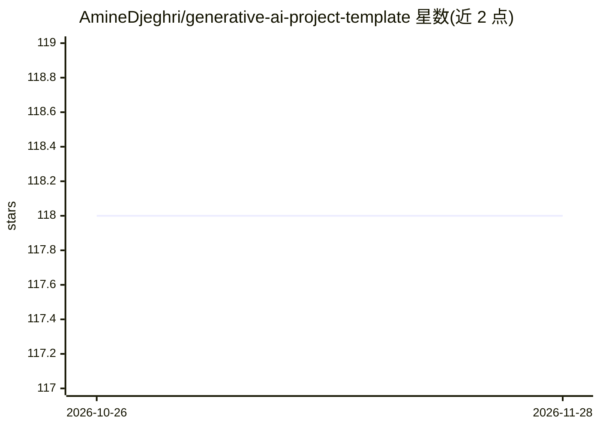

# AmineDjeghri/generative-ai-project-template

⭐ 118 · Python · MIT · 推送 2026-11-27 · [GitHub](https://github.com/AmineDjeghri/generative-ai-project-template) · [官网](http://aminedjeghri.com/generative-ai-project-template/) · 个人维护

**生成式 AI 项目的启动模板：前后端与本地/云端 LLM 接入脚手架**

以模板仓库形式提供的生成式 AI 项目脚手架：FastAPI 后端与 NiceGUI 前端构成聊天应用，模型调用经 LiteLLM 路由到云厂商或本地 Ollama（CPU/GPU），并集成 uv 工作区工具、测试、Docker Compose、GitHub Actions 发布与 MkDocs 文档。通过 Make 命令完成安装、运行、本地 Ollama 准备、容器化部署与文档预览；模型提供方经 .env 中的 INFERENCE_*/EMBEDDINGS_* 配置。限制：仅面向新项目初始化，需自备 Git/uv/Make 环境。

## 筛选速览

| 维度 | 判定 | 备注 |
|---|---|---|
| AI 角色 | `ai-ecosystem` | LLM/agent 周边工具 |
| 许可风险 | `permissive` | MIT |
| 部署形态 | `self-host` | docker 或自建部署 |
| 模型依赖 | local-ok | 支持本地模型 |
| 硬件要求 | — | 无带数字的原话,不猜 |
| 安装摩擦 | `low` | 无编译、无系统依赖或容器化 |
| 成熟度 | — | 结构信号不足 |

## 能力要点

- FastAPI + NiceGUI 聊天应用模板，经 LiteLLM 接入云/本地模型
- make install-ollama / run-with-ollama 一键准备本地 Ollama
- Docker Compose 提供 CPU 与 CUDA GPU 两种栈（Compose 2.24+）
- uv 工作区、pre-commit 钩子、测试与 GitHub 发布流程内置

## 适用场景

- 初始化一个带聊天前后端的生成式 AI 新项目
- 本地用 Ollama 跑模型、需要容器化与可观测性基建
- 团队需要统一的项目结构、测试与发布规范

## 场景标签

 · 领域:LLM 基础设施/开发模板

## 证据(README 行号)

> L18: A FastAPI backend and NiceGUI frontend for chat, with local Ollama
> L19: or cloud models through LiteLLM. Includes uv workspace tooling, tests,
> L43: For local Ollama, install it with `make install-ollama`, then use `make run-with-ollama`

## 星数曲线

2026-10-26 118 → 2026-11-28 118（+0）

---
*卡片 v1 · prompt 1.4 · 生成 2026-11-28 · 置信度 high · 依据 README sha `f6129be1b7d3` · [字段定义](../../DATASET.md)*
