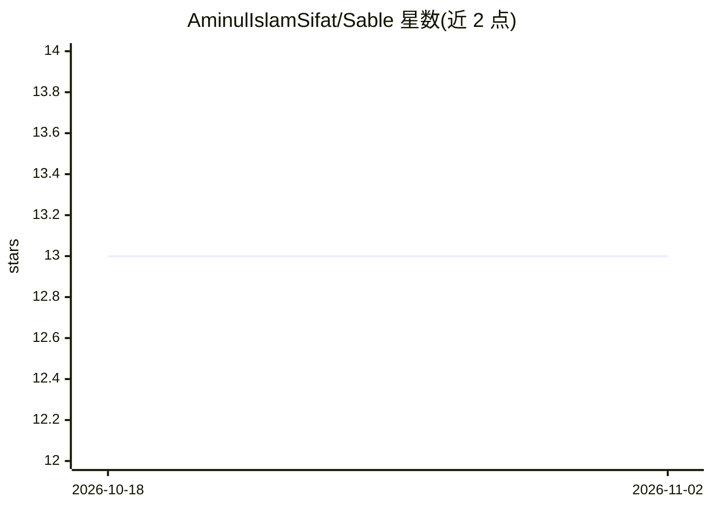

# AminulIslamSifat/Sable

⭐ 13 · Shell · 推送 2026-11-01 · [GitHub](https://github.com/AminulIslamSifat/Sable) · 个人维护

**Sable 桌面应用（自托管 AI 伴侣/代理平台）的发布镜像仓库**

本仓库是 Sable 的发布镜像：托管 AUR 包源码并暂存已构建的桌面发布产物，不含应用源码。Sable 自述为本地自托管代理平台（记忆、技能、陪伴与开发环境角色），但本 README 仅涉及打包分发：提供 AppImage（便携免安装免 root）、deb 包与 Arch 的 sable-bin AUR 包三种 Linux 安装途径；构建流程在 Sable 源仓库由 build_app/build.py 驱动，用 PyInstaller 冻结 Python 服务端并打包 Electron 应用。应用自身能力细节不在本仓库文档范围内。

## 筛选速览

| 维度 | 判定 | 备注 |
|---|---|---|
| AI 角色 | `ai-native` | 本体是模型或模型工具 |
| 许可风险 | `none` | — |
| 部署形态 | `desktop` | 安装包/桌面程序 |
| 模型依赖 | — | README 未给出锁定关系 |
| 硬件要求 | — | 无带数字的原话,不猜 |
| 安装摩擦 | `low` | 无编译、无系统依赖或容器化 |
| 成熟度 | — | 结构信号不足 |

## 能力要点

- 仅含 AUR 包源与发布产物，应用源码在 Sable 仓库
- 三种 Linux 桌面分发：AppImage / deb / AUR sable-bin
- AppImage 自带服务端二进制，无需 Python 或系统运行时
- PyInstaller 冻结 Python 服务端 + Electron 打包的构建流程

## 适用场景

- 在 Arch/Debian/通用 Linux 上安装 Sable 桌面应用
- 获取 Sable 各版本的预构建发布包
- 复用 AUR PKGBUILD 自动再生与构建验证流程

## 场景标签

`AI 助手` · 领域:对话与助手

## 证据(README 行号)

> L3: > Release mirror for Sable — built packages live here.
> L5: This repo holds the **AUR package source** and stages **built release artifacts** for Sable. It contains no applicat

## 星数曲线

2026-10-18 13 → 2026-11-02 13（+0）

---
*卡片 v1 · prompt 1.4 · 生成 2026-11-01 · 置信度 low · 依据 README sha `a6d206d323d2` · [字段定义](../../DATASET.md)*
