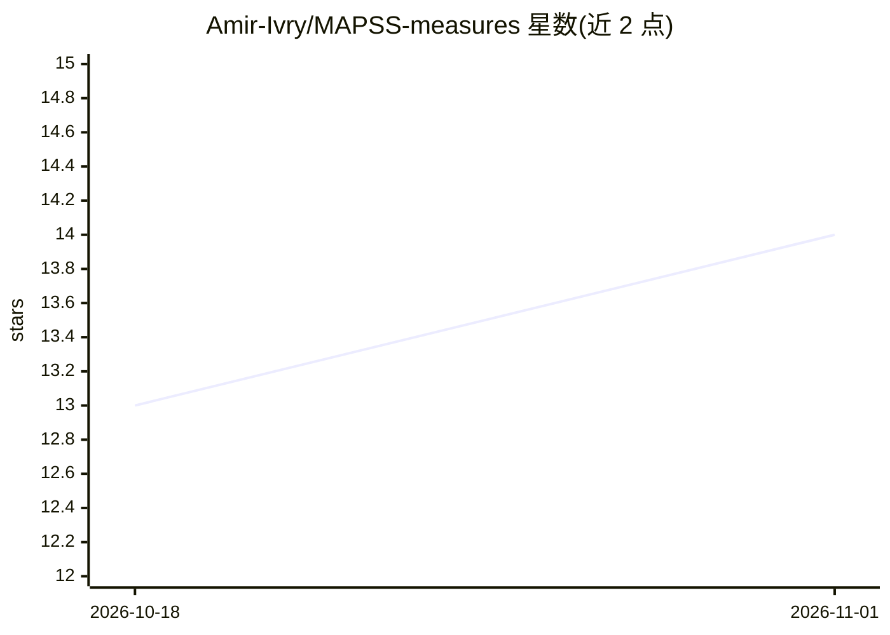

# Amir-Ivry/MAPSS-measures

⭐ 14 · Python · MIT · 推送 2026-08-11 · [GitHub](https://github.com/Amir-Ivry/MAPSS-measures) · [官网](https://arxiv.org/abs/2509.09212v3) · 个人维护

**源分离系统感知质量评测指标包（ICLR 2026）**

MAPSS 是 ICLR 2026 论文的配套 Python 指标包，用于评测音频源分离系统：输出两个 [0,1] 区间的帧级指标——感知分离度（PS，估计源与竞争参考的分离程度）和感知匹配度（PM，估计源与对应参考的感知一致性）。机制上基于流形/扩散映射，使用 wav2vec2 等自监督表示作为骨干（首次使用时从 Hugging Face 下载），支持 WAV 路径、NumPy 数组和 PyTorch 张量输入。限制：要求至少两个源且不自动调整源分配；输入被下混为单声道并重采样到 16 kHz；默认拒绝不等长信号。以 pip 包、Python API 和命令行两种方式提供。

## 筛选速览

| 维度 | 判定 | 备注 |
|---|---|---|
| AI 角色 | `ai-native` | 本体是模型或模型工具 |
| 许可风险 | `permissive` | MIT |
| 部署形态 | `library` | 以包/库形式分发 |
| 模型依赖 | — | README 未给出锁定关系 |
| 硬件要求 | — | 无带数字的原话,不猜 |
| 安装摩擦 | `medium` | 含编译或系统依赖之一 |
| 成熟度 | — | 结构信号不足 |

## 能力要点

- 两个帧级互补指标：感知分离度（PS）与感知匹配度（PM），取值 [0,1]
- 支持多种自监督表示骨干：wav2vec2/wavlm/hubert 及变体，模型首次使用时从 Hugging Face 下载
- 输出 CSV 逐帧得分与论文式六面板时间对齐图（含确定性误差半径与 95% 概率界）
- 提供 Python API 与命令行两种运行方式，支持 CUDA 与 CPU

## 适用场景

- 我需要客观评测语音或音乐源分离系统的感知质量
- 我要在论文或挑战赛报告中报告帧级 PS/PM 指标
- 我想对比不同分离系统输出的感知差异并可视化随时间变化

## 场景标签

`模型评测` · 领域:评测与运维

## 证据(README 行号)

> L9: MAPSS (**Manifold-based Assessment of Perceptual Source Separation**) is an ICLR 2026
> L10: metric package for source-separation systems. It reports two complementary frame-level
> L13: - **Perceptual Separation (PS):** separation of an estimated source from competing references.
> L14: - **Perceptual Match (PM):** perceptual match between an estimated source and its assigned reference.

## 星数曲线

2026-10-18 13 → 2026-11-01 14（+1）

---
*卡片 v1 · prompt 1.4 · 生成 2026-10-31 · 置信度 high · 依据 README sha `22ca563d9331` · [字段定义](../../DATASET.md)*
