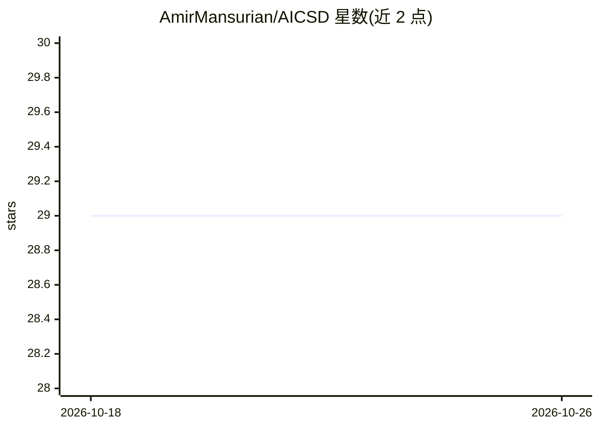

# AmirMansurian/AICSD

⭐ 29 · Python · 推送 2026-06-08 · [GitHub](https://github.com/AmirMansurian/AICSD) · 个人维护

**语义分割的知识蒸馏方法 AICSD 官方实现（MTAP 2025）**

AICSD（Adaptive Inter-Class Similarity Distillation）论文的 PyTorch 源码：将网络输出展平并 softmax 得到类内分布，计算 KL 散度构建类间相似度矩阵，在师生矩阵间定义 MSE 蒸馏损失，叠加像素级 KL 蒸馏与交叉熵损失，并采用随 epoch 自适应增长的权重 α 融合三项损失。README 提供 PASCAL VOC 2012 与 CityScapes 上的 mIoU 对比表、训练命令（train_kd.py）、预训练教师模型（ResNet101-DeepLabV3+）下载说明。代码基于 A Comprehensive Overhaul of Feature Distillation 代码库修改。

## 筛选速览

| 维度 | 判定 | 备注 |
|---|---|---|
| AI 角色 | `ai-native` | 本体是模型或模型工具 |
| 许可风险 | `none` | — |
| 部署形态 | `None` |  |
| 模型依赖 | — | README 未给出锁定关系 |
| 硬件要求 | — | 无带数字的原话,不猜 |
| 安装摩擦 | `low` | 无编译、无系统依赖或容器化 |
| 成熟度 | — | 结构信号不足 |

## 能力要点

- 类间相似度矩阵蒸馏：类内分布 KL 散度 + 师生矩阵 MSE 损失
- 自适应权重 α 随 epoch 渐增，融合蒸馏与分割损失
- PASCAL VOC 2012 与 CityScapes 上的 mIoU/精度对比数据
- 提供 train_kd.py 训练命令与预训练教师模型下载说明

## 适用场景

- 复现论文中的语义分割蒸馏实验
- 训练更小的分割学生网络（ResNet18/MobileNet-V2）
- 在自选 backbone 与数据集上运行 KD/AICSD 训练流程

## 场景标签

`模型训练` · 领域:训练与推理

## 证据(README 行号)

> L6:  This repository contains the source code of AICSD (Adaptive Inter-Class Similarity Distillation for Semantic Segmen
> L12: **Overall diagram of the proposed AICSD**. Network outputs are flattened into 1D vectors, followed by application o

## 星数曲线

2026-10-18 29 → 2026-10-26 29（+0）

---
*卡片 v1 · prompt 1.4 · 生成 2026-10-26 · 置信度 high · 依据 README sha `10acfe6807a8` · [字段定义](../../DATASET.md)*
