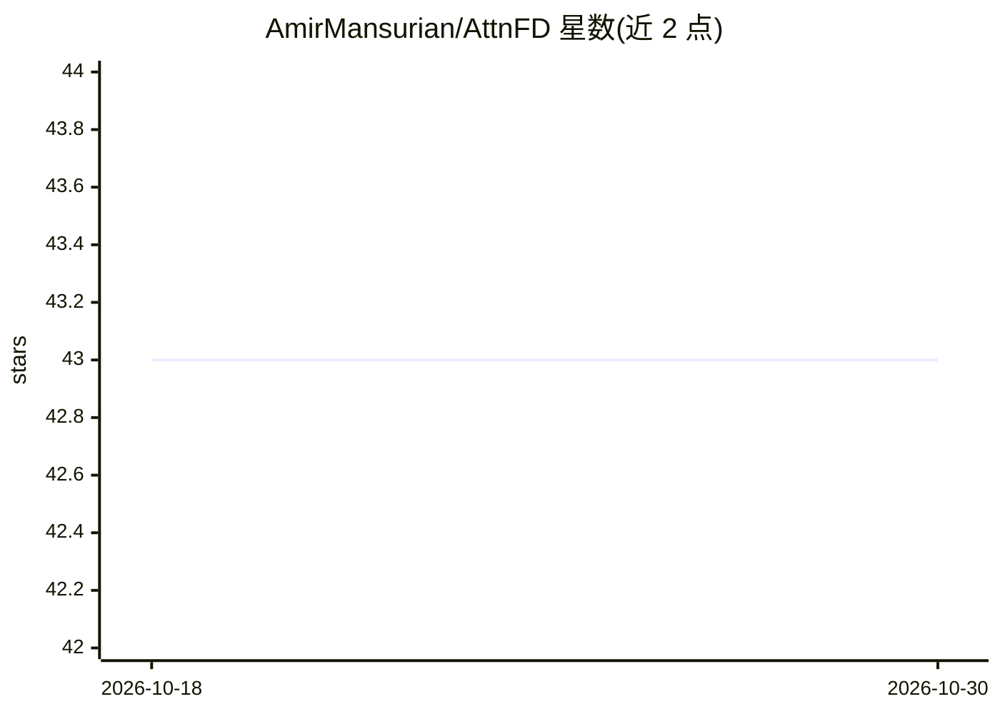

# AmirMansurian/AttnFD

⭐ 43 · Python · 推送 2026-06-08 · [GitHub](https://github.com/AmirMansurian/AttnFD) · 个人维护

**语义分割的特征蒸馏方法官方实现（WACV26 论文）**

WACV26 LENS Workshop 论文 Attention as Geometric Transformation 的 PyTorch 源码：将注意力建模为几何变换，用于语义分割的 teacher-student 特征蒸馏。支持 PascalVOC 与 Cityscapes 数据集，提供 ResNet101-DeepLabV3+ teacher 模型下载、无蒸馏与蒸馏训练脚本（train.py / train_kd.py）。依赖 Python3、PyTorch(>0.4.1)、torchvision、numpy 等。README 给出两个数据集上与 KD/Overhaul/DistKD/CIRKD/LAD 等方法的 mIoU 对比表。代码库基于 Overhaul 特征蒸馏代码修改。

## 筛选速览

| 维度 | 判定 | 备注 |
|---|---|---|
| AI 角色 | `ai-native` | 本体是模型或模型工具 |
| 许可风险 | `none` | — |
| 部署形态 | `None` |  |
| 模型依赖 | — | README 未给出锁定关系 |
| 硬件要求 | — | 无带数字的原话,不猜 |
| 安装摩擦 | `low` | 无编译、无系统依赖或容器化 |
| 成熟度 | — | 结构信号不足 |

## 能力要点

- 注意力作为几何变换的特征蒸馏方法（AttnFD）
- 提供 PascalVOC / Cityscapes 上的训练脚本与 teacher 模型下载
- README 含与多个蒸馏方法的 mIoU 结果对比表

## 适用场景

- 复现论文中的语义分割蒸馏实验
- 在 PascalVOC 或 Cityscapes 上训练压缩的学生分割模型
- 作为特征蒸馏研究的对比基线代码

## 场景标签

`微调` · 领域:训练与推理

## 证据(README 行号)

> L1: ## Attention as Geometric Transformation: Revisiting Feature Distillation for Semantic Segmentation (WACV26 - LENS W
> L6: The source code of (Attention as Geometric Transformation: Revisiting Feature Distillation for Semantic Segmentation
> L37:   python train_kd.py --backbone resnet18 --dataset pascal --nesterov --epochs 120 --batch-size 6 --attn_lambda 2

## 星数曲线

2026-10-18 43 → 2026-10-30 43（+0）

---
*卡片 v1 · prompt 1.4 · 生成 2026-10-25 · 置信度 high · 依据 README sha `a1a77a59a851` · [字段定义](../../DATASET.md)*
