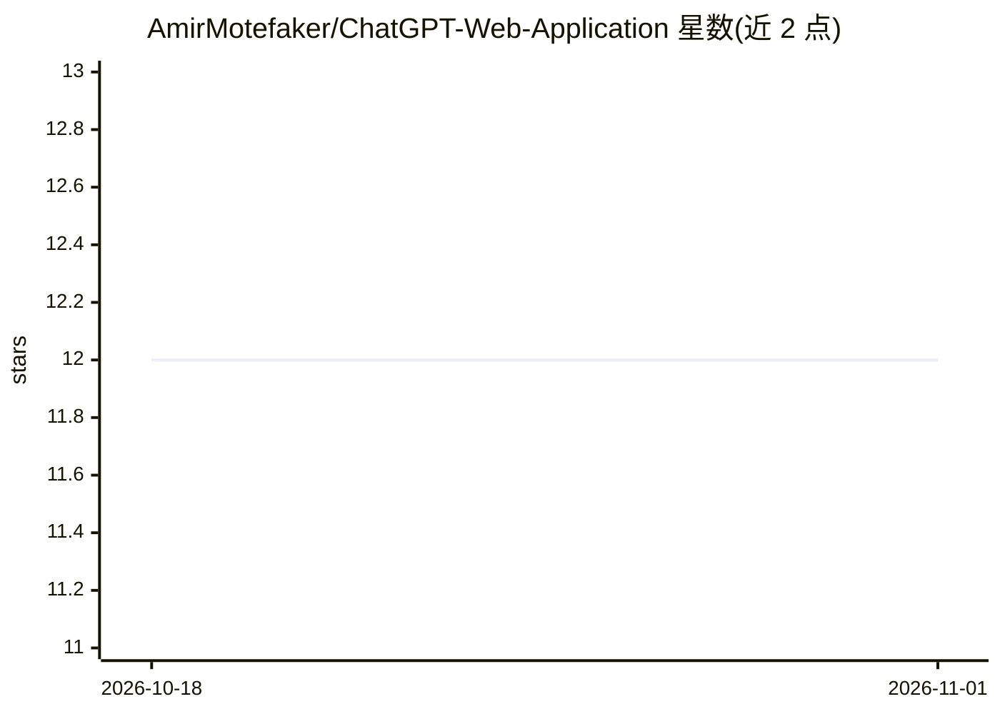

# AmirMotefaker/ChatGPT-Web-Application

⭐ 12 · Jupyter Notebook · 推送 2026-10-29 · [GitHub](https://github.com/AmirMotefaker/ChatGPT-Web-Application) · 个人维护

**基于 Streamlit 的 ChatGPT 式网页聊天应用**

一个可运行的 Streamlit 聊天应用，调用 OpenAI Responses API 实现多轮对话，默认模型 gpt-5.5，可通过环境变量或侧边栏切换；换模型会重置会话链以避免状态混淆。openai_service.py 将 API 调用与 UI 分离，可在不发付费请求的情况下做契约测试。仓库同时保留 Colab/Kaggle/Gradio 形式的历史教学笔记本作为存档，并注明其中可能包含旧模型名或已弃用的 API 用法。面向想运行或学习 ChatGPT 式应用搭建的开发者。

## 筛选速览

| 维度 | 判定 | 备注 |
|---|---|---|
| AI 角色 | `ai-native` | 本体是模型或模型工具 |
| 许可风险 | `none` | — |
| 部署形态 | `library` | 以包/库形式分发 |
| 模型依赖 | — | README 未给出锁定关系 |
| 硬件要求 | — | 无带数字的原话,不猜 |
| 安装摩擦 | `low` | 无编译、无系统依赖或容器化 |
| 成熟度 | — | 结构信号不足 |

## 能力要点

- 使用 OpenAI Responses API（client.responses.create）实现多轮对话
- 侧边栏切换模型与清除会话，换模型自动重置对话链
- API 层与 UI 分离，支持离线单元测试
- 保留 5 个 Colab/Kaggle/Gradio 历史教学笔记本存档

## 适用场景

- 本地跑一个网页版 ChatGPT 式聊天界面
- 学习 OpenAI Responses API 与 Streamlit 的集成方式
- 参考历史 Gradio/Colab 笔记本对比新旧 API 用法

## 场景标签

`聊天机器人` `教程课程` · 领域:对话与助手

## 证据(README 行号)

> L7: A runnable Streamlit chat application using the modern OpenAI Responses API, while preserving the project's original
> L16: - `client.responses.create(...)`

## 星数曲线

2026-10-18 12 → 2026-11-01 12（+0）

---
*卡片 v1 · prompt 1.4 · 生成 2026-11-01 · 置信度 mid · 依据 README sha `11eb85927c8e` · [字段定义](../../DATASET.md)*
