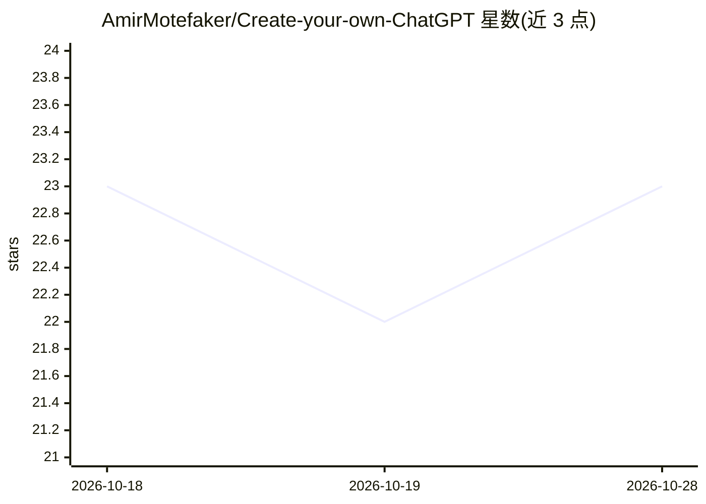

# AmirMotefaker/Create-your-own-ChatGPT

⭐ 23 · Jupyter Notebook · 推送 2026-10-25 · [GitHub](https://github.com/AmirMotefaker/Create-your-own-ChatGPT) · 个人维护

**用 Python 调用 OpenAI Responses API 自建命令行 ChatGPT 示例**

提供现代入口 chat.py 与 openai_service.py：基于官方 OpenAI Python SDK 的 responses.create 调用，通过 OPENAI_API_KEY 鉴权，用 previous_response_id 维持多轮对话，默认模型 gpt-5.5 且可用 OPENAI_MODEL 或 --model 覆盖。安装走 git clone 加 venv 与 requirements.txt，支持单条 prompt 与交互式会话两种运行方式。同时保留 2023 年代的历史 Jupyter 笔记本作为教育存档，README 注明其含过时 API 用法。仓库带离线单测与 GitHub Actions 验证（Python 3.10/3.12），CI 不发起付费 API 请求。

## 筛选速览

| 维度 | 判定 | 备注 |
|---|---|---|
| AI 角色 | `ai-native` | 本体是模型或模型工具 |
| 许可风险 | `none` | — |
| 部署形态 | `library` | 以包/库形式分发 |
| 模型依赖 | — | README 未给出锁定关系 |
| 硬件要求 | — | 无带数字的原话,不猜 |
| 安装摩擦 | `low` | 无编译、无系统依赖或容器化 |
| 成熟度 | — | 结构信号不足 |

## 能力要点

- 基于官方 OpenAI SDK 的 Responses API CLI（chat.py）
- previous_response_id 维持多轮对话状态
- 默认模型 gpt-5.5，可用环境变量或 --model 覆盖
- 保留 2023 年历史 Jupyter 笔记本作为教育存档，并有离线单测与 CI 验证

## 适用场景

- 学习如何用 OpenAI Responses API 构建对话 CLI
- 在终端跑单条 prompt 或交互式多轮会话
- 查阅早期 ChatGPT 实验的历史笔记本文档

## 场景标签

`聊天机器人` `教程课程` · 领域:对话与助手

## 证据(README 行号)

> L11: The supported entry point is `chat.py`, backed by `openai_service.py`.
> L16: - `client.responses.create(...)`

## 星数曲线

2026-10-18 23 → 2026-10-28 23（+0）

---
*卡片 v1 · prompt 1.4 · 生成 2026-10-28 · 置信度 mid · 依据 README sha `30681c010da2` · [字段定义](../../DATASET.md)*
