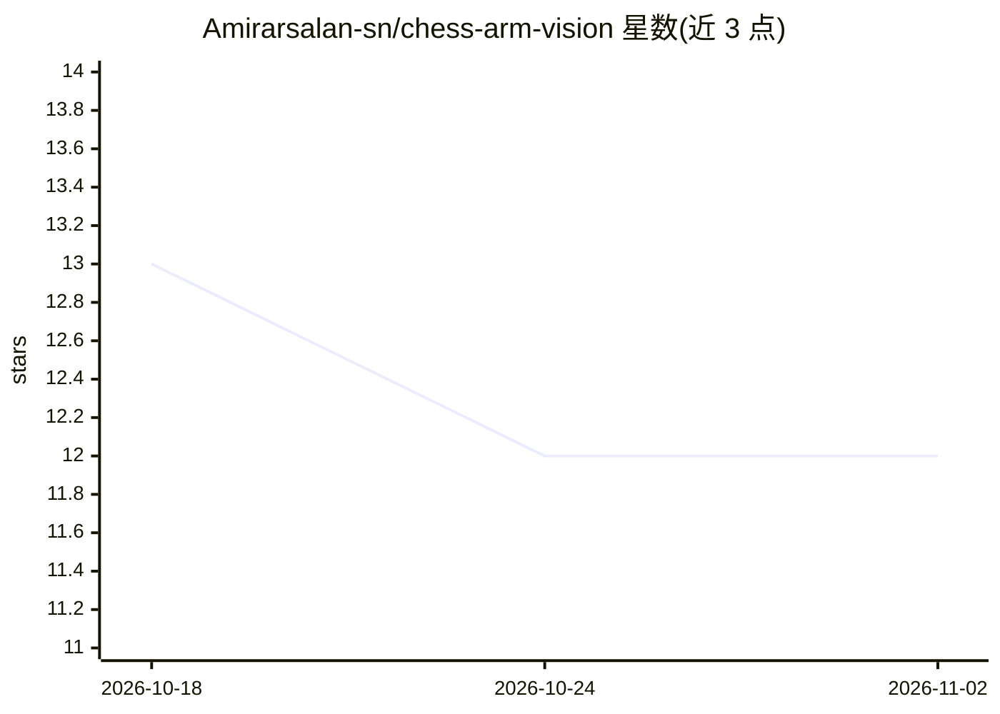

# Amirarsalan-sn/chess-arm-vision

⭐ 12 · Python · MIT · 推送 2026-06-20 · [GitHub](https://github.com/Amirarsalan-sn/chess-arm-vision) · 个人维护

**机械臂自动下国际象棋的机器人系统源码**

Dchess 是一个机器人国际象棋对弈系统，配合 Dobot Magician 机械臂实现棋盘感知与走子执行，涉及计算机视觉（YOLO）、机器学习决策与运动规划。仓库为论文《RoBoard: a Platform to Teach Robots How to Play Board Games》的配套源码，含 BibTeX 引用信息。README 仅展示标题、论文出处与引用块，未展示安装运行说明。

## 筛选速览

| 维度 | 判定 | 备注 |
|---|---|---|
| AI 角色 | `ai-native` | 本体是模型或模型工具 |
| 许可风险 | `permissive` | MIT |
| 部署形态 | `None` |  |
| 模型依赖 | — | README 未给出锁定关系 |
| 硬件要求 | — | 无带数字的原话,不猜 |
| 安装摩擦 | `low` | 无编译、无系统依赖或容器化 |
| 成熟度 | — | 结构信号不足 |

## 能力要点

- 机械臂国际象棋对弈系统（Dobot Magician）
- 涉及 YOLO 目标检测、决策与运动规划
- ICSPIS 2025 论文 RoBoard 的配套源码

## 适用场景

- 复现论文中的机器人下棋平台
- 学习机械臂+视觉+决策的集成实现

## 场景标签

`目标检测` · 领域:感知与多模态

## 证据(README 行号)

> L1: # Dchess, a robotic chess player
> L2: This repository is the source code for the article:

## 星数曲线

2026-10-18 13 → 2026-11-02 12（-1）

---
*卡片 v1 · prompt 1.4 · 生成 2026-11-01 · 置信度 low · 依据 README sha `fe04c4028e62` · [字段定义](../../DATASET.md)*
