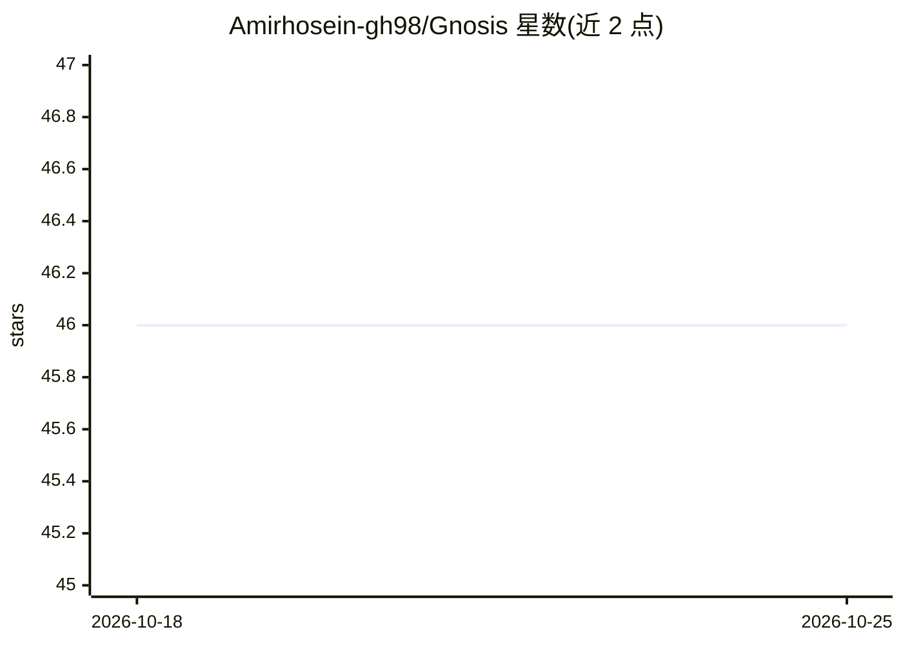

# Amirhosein-gh98/Gnosis

⭐ 46 · Python · 推送 2026-07-15 · [GitHub](https://github.com/Amirhosein-gh98/Gnosis) · 个人维护

**科研工作：给冻结 LLM 附加自意识头，预测回答的正确概率**

论文配套代码库：Gnosis 是挂在冻结 LLM 骨干上的轻量自意识头（self-awareness head），读取模型隐藏状态与注意力图，对生成回答输出标量正确性概率，用于幻觉/错误检测。仓库包含集成 Gnosis 的 Transformers fork（GPT-OSS、Qwen3 架构）、修改 SFTTrainer 的 TRL fork、基于 open-r1 的训练配置与推理打分脚本。安装提供一键脚本或 conda 手动流程，训练配置面向 2×A100 GPU，提供 arXiv 论文与 HuggingFace 数据/模型集合链接。

## 筛选速览

| 维度 | 判定 | 备注 |
|---|---|---|
| AI 角色 | `ai-ecosystem` | LLM/agent 周边工具 |
| 许可风险 | `none` | — |
| 部署形态 | `None` |  |
| 模型依赖 | local-ok | 支持本地模型 |
| 硬件要求 | — | 无带数字的原话,不猜 |
| 安装摩擦 | `low` | 无编译、无系统依赖或容器化 |
| 成熟度 | — | 结构信号不足 |

## 能力要点

- 读取隐藏状态+注意力图输出标量正确性概率
- Transformers/TRL fork 形式集成进 GPT-OSS 与 Qwen3 架构
- 基于 open-r1 的训练流程与多基准打分脚本（Math/TriviaQA/MMLU-Pro）
- 配套 arXiv 论文与 HuggingFace 数据/模型集合

## 适用场景

- 复现论文中的 LLM 失败预测/幻觉检测实验
- 为已生成的回答打正确性概率分
- 在自有数据集上训练 Gnosis 头

## 场景标签

`科研工具` `模型评测` · 领域:评测与运维

## 证据(README 行号)

> L21: **Gnosis** is a lightweight **self-awareness head** attached to a *(frozen)* LLM backbone that predicts a **scalar 
> L143: @article{ghasemabadi2025can,

## 星数曲线

2026-10-18 46 → 2026-10-25 46（+0）

---
*卡片 v1 · prompt 1.4 · 生成 2026-10-25 · 置信度 high · 依据 README sha `ed156efbc7dc` · [字段定义](../../DATASET.md)*
