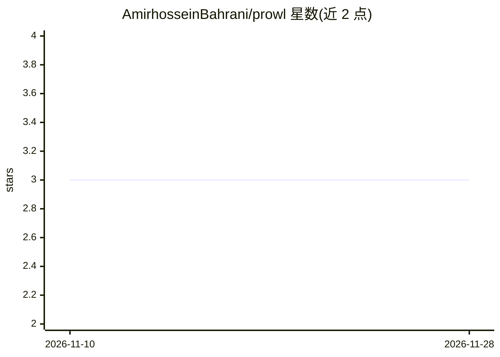

# AmirhosseinBahrani/prowl

⭐ 3 · Rust · Apache-2.0 · 推送 2026-10-22 · [GitHub](https://github.com/AmirhosseinBahrani/prowl) · 个人维护

**用本地 Claude Code 自动审查请求你的 GitHub PR 的后台守护+TUI**

PRowl 以每分钟轮询 GitHub，找出请求你审查的 PR，在本地检出代码后调用你已登录的 Claude Code CLI，按你自写的 Markdown Review Policy 生成结构化审查意见，并自动发布或在命中策略时标记为等待人工批准。安全机制包括沙箱只读会话、禁 shell/网络/MCP、不执行 PR 代码、提示注入与隐藏 Unicode 检测、凭据脱敏。支持无人值守运行（重试、崩溃恢复、每日预算）与 TUI/CLI 双操作界面。

## 筛选速览

| 维度 | 判定 | 备注 |
|---|---|---|
| AI 角色 | `ai-native` | 本体是模型或模型工具 |
| 许可风险 | `permissive` | Apache-2.0 |
| 部署形态 | `library` | 以包/库形式分发 |
| 模型依赖 | locked-api |  |
| 硬件要求 | — | 无带数字的原话,不猜 |
| 安装摩擦 | `low` | 无编译、无系统依赖或容器化 |
| 成熟度 | — | 结构信号不足 |

## 能力要点

- 按用户自写的 Markdown Review Policy 决定 AI 审查或转人工
- 沙箱只读会话审查不可信代码，不执行 PR 代码，抗提示注入
- TUI 七个标签页管理队列、审查历史、策略版本与设置
- 策略命中的 PR 默认需人工批准，agent verdicts 可选开启

## 适用场景

- 被多个仓库请求 PR 审查时用 AI 先行过滤与初审
- 为鉴权、支付、迁移类改动强制保留人工审查
- 夜间/无人值守时段持续跟进 PR 审查线程与修复验证

## 场景标签

`代码审查` · 领域:编码与开发

## 证据(README 行号)

> L10: PRowl watches GitHub for pull requests where **you** are a requested reviewer, reviews them with
> L58: 2. **Review** — the PR is checked out in a throwaway worktree; Claude reads the diff PRowl prepared
> L59:  and the surrounding code, guided by your Review Policy, and answers with structured findings.

## 星数曲线

2026-11-10 3 → 2026-11-28 3（+0）

---
*卡片 v1 · prompt 1.4 · 生成 2026-11-22 · 置信度 high · 依据 README sha `8c0be1bb62f3` · [字段定义](../../DATASET.md)*
