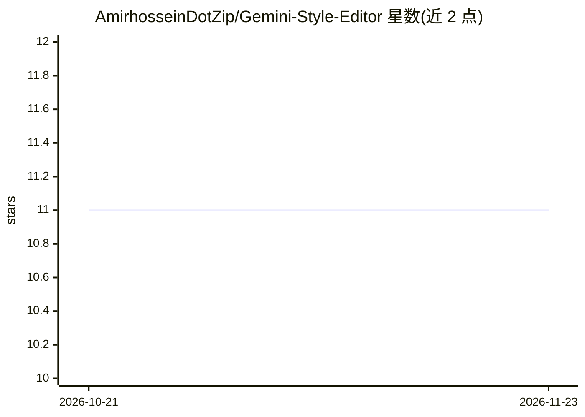

# AmirhosseinDotZip/Gemini-Style-Editor

⭐ 11 · JavaScript · 推送 2026-07-19 · [GitHub](https://github.com/AmirhosseinDotZip/Gemini-Style-Editor) · 个人维护

**为 Google Gemini 网页提供波斯语字体与界面宽度定制的 Chrome 扩展**

一个针对 gemini.google.com 的 Chrome 扩展，作者因默认波斯语字体可读性差而开发。提供 Vazirmatn 字体切换（默认）、自定义 Google Fonts URL 解析应用、对话区扩展至视口 90% 宽度三项功能，作用于含代码块与 :lang(fa) 的文本元素；设置存于 chrome.storage.sync 并持久生效，弹窗 UI 跟随系统明暗主题。仅通过开发者模式加载源码安装，无内置 AI 功能。

## 筛选速览

| 维度 | 判定 | 备注 |
|---|---|---|
| AI 角色 | `ai-enhanced` | 去掉 AI 部分产品仍成立 |
| 许可风险 | `none` | — |
| 部署形态 | `None` |  |
| 模型依赖 | — | README 未给出锁定关系 |
| 硬件要求 | — | 无带数字的原话,不猜 |
| 安装摩擦 | `low` | 无编译、无系统依赖或容器化 |
| 成熟度 | — | 结构信号不足 |

## 能力要点

- 一键为 Gemini 界面应用 Vazirmatn 波斯语字体（含代码块与 :lang(fa)）
- 粘贴 Google Fonts URL 即可解析并应用自定义字体
- 扩展模式将对话容器与输入框宽度调至视口 90%
- 偏好保存至 chrome.storage.sync，随明暗主题自适应

## 适用场景

- 在 Gemini 上用波斯语对话时改善字体可读性
- 宽屏下拓宽 Gemini 对话区域以提升阅读体验
- 用自己偏好的 Google 字体统一聊天界面样式

## 场景标签

 · 领域:浏览器扩展/界面定制

## 证据(README 行号)

> L6: A simple Chrome extension I made for my personal use, because the default Persian font on Google Gemini chatbot was 
> L12: * **Custom Font Toggle:**
> L19: * **Expanded Content Width:**

## 星数曲线

2026-10-21 11 → 2026-11-23 11（+0）

---
*卡片 v1 · prompt 1.4 · 生成 2026-11-19 · 置信度 high · 依据 README sha `75b83e2b444c` · [字段定义](../../DATASET.md)*
