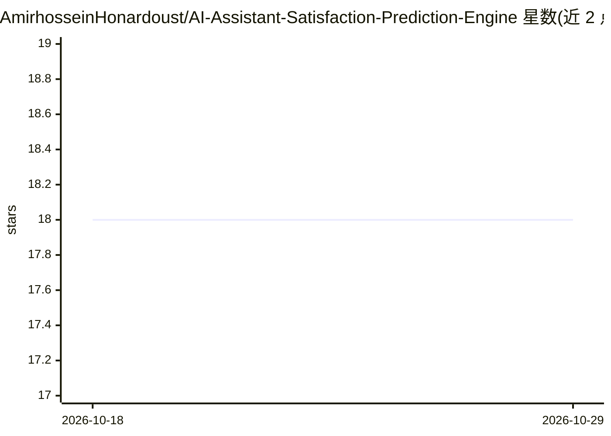

# AmirhosseinHonardoust/AI-Assistant-Satisfaction-Prediction-Engine

⭐ 18 · Python · MIT · 推送 2026-07-04 · [GitHub](https://github.com/AmirhosseinHonardoust/AI-Assistant-Satisfaction-Prediction-Engine) · 个人维护

**从会话行为预测 AI 助手满意度评分的 ML 工作流演示**

作者自述为作品集与研究演示，非生产系统：基于文档化的合成数据生成过程产生日度使用数据，做时间特征工程后训练 scikit-learn RandomForest 流水线，预测 1-5 档满意度评分；评估覆盖 MAE、二次加权 kappa、ECE 校准等序数感知指标，含多数类基线与 Frank & Hall 序数模型对照；用 SHAP 做全局与逐会话解释，并提供 Streamlit 交互式面板与新 CSV 打分命令。README 明确声明不测量真实用户满意度、不含监控/漂移检测等生产设施。

## 筛选速览

| 维度 | 判定 | 备注 |
|---|---|---|
| AI 角色 | `ai-native` | 本体是模型或模型工具 |
| 许可风险 | `permissive` | MIT |
| 部署形态 | `library` | 以包/库形式分发 |
| 模型依赖 | — | README 未给出锁定关系 |
| 硬件要求 | — | 无带数字的原话,不猜 |
| 安装摩擦 | `low` | 无编译、无系统依赖或容器化 |
| 成熟度 | — | 结构信号不足 |

## 能力要点

- 文档化合成数据生成器，固定 RANDOM_STATE 全流程可复现
- 序数感知评估（QWK 0.726、MAE 0.713）与多数类基线对照
- SHAP 全局与逐会话解释，版本兼容处理
- Streamlit 面板支持上传会话 CSV 分段查看与逐条解释
- GitHub Actions 双作业：质量门禁 + 端到端流水线产物发布

## 适用场景

- 学习一个含校准诊断与可解释性的完整 sklearn 建模流程
- 演示序数分类与平坦多类分类的可复现对照实验
- 上传会话 CSV 获得满意度预测与逐条 SHAP 解释

## 场景标签

 · 领域:机器学习/数据分析

## 证据(README 行号)

> L10: A behavioral machine-learning workflow for turning AI-assistant session logs into **satisfaction predictions**, **o
> L28: This project demonstrates that end-to-end workflow on a synthetic daily-usage dataset. It generates data from a doc

## 星数曲线

2026-10-18 18 → 2026-10-29 18（+0）

---
*卡片 v1 · prompt 1.4 · 生成 2026-10-29 · 置信度 high · 依据 README sha `371ca832b946` · [字段定义](../../DATASET.md)*
