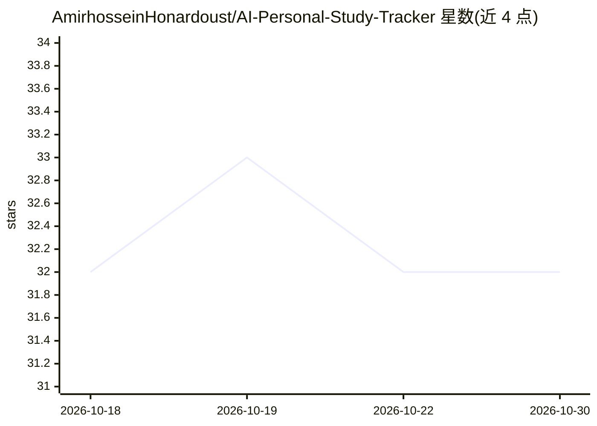

# AmirhosseinHonardoust/AI-Personal-Study-Tracker

⭐ 32 · Python · MIT · 推送 2025-11-20 · [GitHub](https://github.com/AmirhosseinHonardoust/AI-Personal-Study-Tracker) · 个人维护

**面向学习者的个人学习追踪与生产力预测应用**

基于 Python、Streamlit、SQLite 构建的学习生产力分析应用：用户记录每日学习会话（时长、科目、心情、干扰次数、咖啡因摄入等），应用基于 scikit-learn 的 RandomForestRegressor 训练历史数据，预测期望生产力（1-5 分），并通过 Streamlit + Plotly 仪表盘展示时间趋势、分科平均与 KPI。数据存储在本地 SQLite 数据库。模型为模块化设计，README 提及可替换为 XGBoost 或神经网络。安装方式为 git clone 源码运行。

## 筛选速览

| 维度 | 判定 | 备注 |
|---|---|---|
| AI 角色 | `ai-native` | 本体是模型或模型工具 |
| 许可风险 | `permissive` | MIT |
| 部署形态 | `None` |  |
| 模型依赖 | — | README 未给出锁定关系 |
| 硬件要求 | — | 无带数字的原话,不猜 |
| 安装摩擦 | `low` | 无编译、无系统依赖或容器化 |
| 成熟度 | — | 结构信号不足 |

## 能力要点

- 记录学习会话（心情、干扰、咖啡因、学习技巧等字段）
- RandomForestRegressor 预测生产力（1-5 分）
- Streamlit + Plotly 仪表盘展示趋势、分科平均与 KPI
- 本地 SQLite 数据库存储，模型可替换为 XGBoost 或神经网络

## 适用场景

- 记录并回顾每日学习情况，查看生产力趋势
- 学习前估算预期生产力
- 查看分科学习时长与效率对比

## 场景标签

`数据分析` · 领域:效率与自动化

## 证据(README 行号)

> L9: It leverages a **Random Forest Regressor** to model productivity based on mood, distractions, study duration, caffei
> L78: The app uses **RandomForestRegressor** from `scikit-learn` trained on historical study logs.

## 星数曲线

2026-10-18 32 → 2026-10-30 32（+0）

---
*卡片 v1 · prompt 1.4 · 生成 2026-10-26 · 置信度 high · 依据 README sha `fefbeaa074a5` · [字段定义](../../DATASET.md)*
