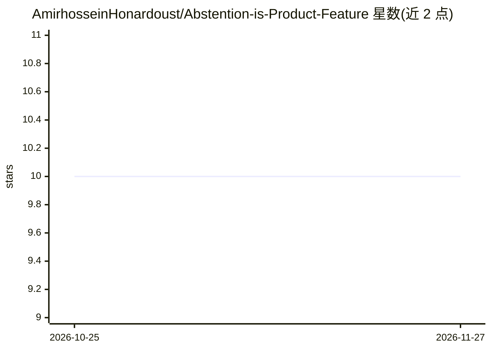

# AmirhosseinHonardoust/Abstention-is-Product-Feature

⭐ 10 · MIT · 推送 2026-04-29 · [GitHub](https://github.com/AmirhosseinHonardoust/Abstention-is-Product-Feature) · 个人维护

**把模型弃答/拒判重新定义为产品设计要素的方法论文章**

一篇长文，主张弃答（selective prediction / reject option）应被视为产品能力而非模型缺陷。内容涵盖：覆盖率作为产品 KPI、校准作为阈值前提、在审核容量与风险约束下的三种阈值选择方法（容量优先/风险优先/成本最小化）、四种弃答路由模式（置信阈值、不确定性+影响、多信号分歧、OOD）、人审队列的容量与 SLA 设计、双层指标体系与弃答 PRD 模板，并列出五类反模式。纯文本方法论，无代码、无安装运行说明，面向 ML/产品/运营团队。

## 筛选速览

| 维度 | 判定 | 备注 |
|---|---|---|
| AI 角色 | `ai-knowledge` | 知识聚合/清单类 |
| 许可风险 | `permissive` | MIT |
| 部署形态 | `None` |  |
| 模型依赖 | — | README 未给出锁定关系 |
| 硬件要求 | — | 无带数字的原话,不猜 |
| 安装摩擦 | `low` | 无编译、无系统依赖或容器化 |
| 成熟度 | — | 结构信号不足 |

## 能力要点

- 覆盖率为 KPI 的弃答经济成本模型：Expected Cost(c) = c·e(c)·C_error + (1−c)·C_review
- 四种弃答路由模式：置信阈值、不确定性+影响、多信号分歧、OOD 路由
- 阈值选择的三种方法：容量优先、风险优先、成本最小化
- 弃答 PRD 模板：策略、审核容量/SLA、双层指标、监控与回滚计划

## 适用场景

- 为带人审环节的自动决策系统设计置信阈值与覆盖率目标
- 规划审核队列的容量、优先级与 SLA
- 给产品/管理层解释弃答策略的成本与风险权衡
- 为弃答系统撰写 PRD 与监控指标

## 场景标签

`模型评测` `教程课程` · 领域:评测与运维

## 证据(README 行号)

> L1: Abstention Is a Product Feature, Not a Model Failure
> L24: This article is about reframing abstention from “model embarrassment” to **product design**: how you build decision
> L55: In ML research, this is called **selective prediction** or **classification with a reject option**.

## 星数曲线

2026-10-25 10 → 2026-11-27 10（+0）

---
*卡片 v1 · prompt 1.4 · 生成 2026-11-20 · 置信度 high · 依据 README sha `281fb8d871d4` · [字段定义](../../DATASET.md)*
