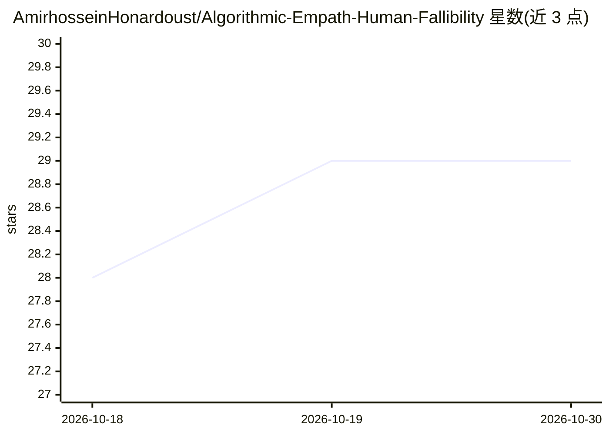

# AmirhosseinHonardoust/Algorithmic-Empath-Human-Fallibility

⭐ 29 · MIT · 推送 2025-11-05 · [GitHub](https://github.com/AmirhosseinHonardoust/Algorithmic-Empath-Human-Fallibility) · 个人维护

**算法共情概念性论文：探讨让模型理解人类易错性**

一篇概念性长文（含少量伪代码与公式），系统阐述"算法共情"框架：将人机决策分歧视为二阶数据集，定义 Empathic Divergence 与 Empathy Index 等数学度量，提出感知/认知对齐/反思/伦理四层设计蓝图与共同学习循环，并讨论共情式 AI 的滥用风险、治理支柱（透明、知情同意、自审计）及哲学反思。文中引用 CognitiveLens 作为示例系统，含参考文献列表。无安装或运行说明，属思想框架而非可运行软件。

## 筛选速览

| 维度 | 判定 | 备注 |
|---|---|---|
| AI 角色 | `ai-knowledge` | 知识聚合/清单类 |
| 许可风险 | `permissive` | MIT |
| 部署形态 | `None` |  |
| 模型依赖 | — | README 未给出锁定关系 |
| 硬件要求 | — | 无带数字的原话,不猜 |
| 安装摩擦 | `low` | 无编译、无系统依赖或容器化 |
| 成熟度 | — | 结构信号不足 |

## 能力要点

- 提出 Empathic Divergence（基于 KL 散度）与 Empathy Index 两个数学度量
- 四层认知架构（感知/认知对齐/反思/伦理）与共同学习四步循环
- 共情式 AI 的风险清单与治理三支柱（透明/同意/反思）
- 附 7 条参考文献与 CognitiveLens 示例引用

## 适用场景

- 研究人机分歧学习与公平性度量的理论框架
- 了解共情式 AI 的伦理风险与治理设计思路
- 作为可解释性与人类中心 AI 讨论的阅读材料

## 场景标签

 · 领域:AI 伦理/人类中心 AI

## 证据(README 行号)

> L9: This is the vision of **Algorithmic Empathy**, the science and philosophy of teaching machines to understand *why* h
> L31: In the **CognitiveLens** framework, disagreement metrics form a second-order dataset: *a dataset about judgment its
> L169: ## References & Suggested Reading

## 星数曲线

2026-10-18 28 → 2026-10-30 29（+1）

---
*卡片 v1 · prompt 1.4 · 生成 2026-10-26 · 置信度 high · 依据 README sha `5ac987ee82ca` · [字段定义](../../DATASET.md)*
